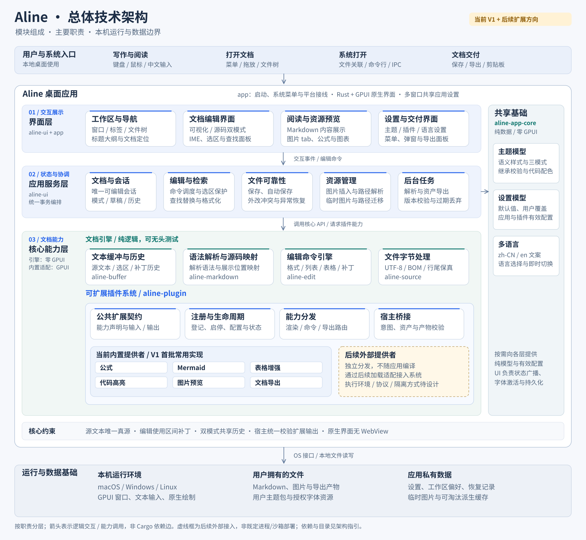
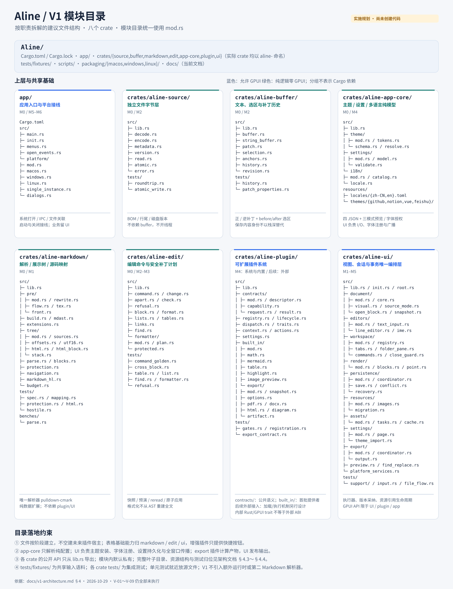

# Aline V1 技术架构指引

版本：0.8 · 主题决定回写版  
更新日期：2026-10-30  
状态：**TA-01～TA-03、RS-01～RS-05、ED-01、UI-01～UI-06、PL-01～PL-03 与 TH-01～TH-10 已确认并回写，当前无待确认问题；技术验证尚未完成，不表示实现或验收通过。**

## 1. 用途、权威关系与阅读顺序

本文回答模块怎么分、由谁负责、按什么顺序实现、怎样验收。适用于 Rust + GPUI 原生桌面 V1，不承接浏览器原型的存储、转换或渲染实现。

权威按职责划分：仓库 [AGENTS.md](../AGENTS.md) 规定架构铁律和工作规则，[PRD 0.9](./v1-prd.md) 规定产品范围与结果，已确认架构及专项规范约束实现，[验证计划](./v1-validation-plan.md) 记录方法、证据状态与待验证边界。决定记录及确认归档用于追踪选择，历史材料不自动取得规范效力；阅读顺序不是同级规范的裁决优先级。同级资料无法按职责解释的冲突须列出，不能按日期、文件位置或实现便利自行选择。已删除目录不再是开发必需输入，历史证据见第 12 节及[迁移证据索引](./archive/migration-evidence/README.md)。

阅读顺序：AGENTS.md → PRD → 验证计划 → 本文 → 引擎指引 → 架构规范 → Rust 规范 → UI 规范 → 对应历史专项证据（第 12 节）。引擎、架构规范、Rust 与 UI 规范均已复核迁入；插件规范及 PL-01～PL-03 已确认回写；主题规范及 TH-01～TH-10 已确认回写；其余历史专项按需复核，不能依据旧稿扩张范围。

措辞约定：**必须**表示由当前契约或铁律推导的实施要求；**建议**表示可替换的技术方案；**待验证**须完成 V-编号所列实验/样本才能冻结；**待确认**须用户裁决；TA-01～TA-03、RS-01～RS-05 与 ED-01 均已确认，第 14 节保留决定摘要和归档入口。本文的接口名和模块路径是实施草图，不代表代码已经存在；具体 Rust 签名可在不改变边界的前提下调整。

## 2. 架构目标、范围与非目标

- 必须以源文本为唯一事实来源，展示树、主题、预览、导出均为投影；编辑通过源码区间补丁，不从 AST 重建 Markdown。
- 必须覆盖 PRD 全部 V1 基线，包括六插件、四套三模式主题、PDF/.docx/HTML 导出、临时图片恢复、多窗口和三平台正式同发。
- M0–M6 组织实现，不是工期承诺；各阶段可形成独立可检查的预览，M1 只读与 M2 内部日用不代表正式 V1 完成。
- 只提供 Visual/Source 两种 Markdown 模式。图片只读 tab 是另一类资源视图，不是第三种 Markdown 模式。
- PRD 第 8 节排除的 AI、云服务、脚本、远程图片请求、WebView、PlantUML 等不进入 V1 实施或依赖清单。插件系统作为核心扩展能力，后续支持独立分发、在应用编译之外加载的外部插件；当前 V1 先交付内置提供者，不将外部加载自动纳入本期。最近记录、完整标签会话、恢复已关闭标签、专注模式、整词查找及折叠标记增强仍是可选项，不进入基线门禁。

局部输入、提交、文件落盘、资源迁移分别有事务边界；不能用“一切都原子”掩盖跨文件不能一次提交的问题。必须通过状态、失败恢复与故障注入验证中间状态。

## 3. 关键约束与技术栈

### 3.1 不可绕过的约束

| 必须满足的约束 | 实施与检查方式 |
|---|---|
| 依赖单向、引擎无 GPUI | 第 4 节图为允许方向；M0 建依赖检查，覆盖直接和传递依赖 |
| 文本只通过补丁改动 | `Vec<(Range<usize>, String)>`，同一基线下升序、不重叠、UTF-8 边界合法；预检失败整批不应用 |
| 块编辑不含尾换行 | 块可编辑范围与块间分隔字节分开记录；提交不能吞掉下一块或文件末尾约定 |
| 坐标只以源码字节持久化 | 按 RS-02，跨模块/跨 crate 的源码、绘制、UTF-16 偏移及范围必须 newtype/受检封装；内部单坐标可明确命名 usize，补丁原语保持既定形状并受检转换；所有转换经过映射层 |
| 文件保真 | 未修改使用原 bytes；修改后只重放 BOM 和原始行尾多数派，平票 LF；逐字节门禁见第 10 节 |
| 单一 Markdown 解析器 | 仅 pulldown-cmark；改写器携带回原文映射，不能另引解析器、AST 序列化器或无映射的全文替换 |
| 引擎可无头运行 | source/buffer/markdown/edit/app-core 无 GPUI、无线程、无全局状态，禁 `unwrap()`，用户输入不 panic |
| 翻译从第一天接线 | `t("key")`；zh-CN/en TOML catalog、rust-embed；引擎返回错误枚举，UI 才翻译 |
| 实现纪律 | 中文注释与文档、英文标识符；TODO 与提交格式遵守 AGENTS.md；新机制先测试再 UI |

### 3.2 栈与依赖的状态

| 范围 | 当前约束 / 采用依据 | 冻结条件 |
|---|---|---|
| Rust / GPUI | Rust，`gpui-pre` 单一来源且精确锁版；禁止为方便改用另一代 GPUI | M0 记录工具链、edition、锁定版本与补丁；旧 `=0.3.9` 是历史快照证据，须核对锁定源码，不宣称平台能力通过 |
| 解析 | pulldown-cmark + 自建带区间的中间树/展示树；默认 features 关闭后显式选择语法选项 | M0 用 PRD 语法夹具固定选项与输出 |
| 文本缓冲 | 建议从 StringBuffer + 行索引 + 补丁历史开始；保留 Buffer 接口 | V-05 决定行索引增量维护等优化；不预装 ropey，也不能靠调小阈值缩减契约 |
| 公式/图表/高亮 | 历史候选 ratex（及 SVG 输出）、mermaid-rs-renderer、usvg、syntect；two-face 为可选语法集 | V-03/V-06 验证覆盖率、资源预算；这些是候选后端，失败回退不等于需求已完成 |
| 配置与打包资源 | 主题包为静态 JSON；文案为 TOML + rust-embed；设置序列化格式为内部实现细节 | schema 1 与字段/继承规则已按 TH-01～05 确认，数值/资源限额和平台能力仍验 V-04；不能用旧 TOML 替代 JSON |
| 基础工具 | 历史清单的 toml、rust-embed、blake3、directories、rfd，以及 diff 候选 similar、测试 proptest | 引入前逐项登记用途、所属 crate、精确版本及许可证；未使用的不添加 |
| 导出 / ZIP / 平台集成 | 旧架构没有给出可执行的 PDF/.docx/HTML 后端及安全解包依赖闭环 | V-02/V-04/V-01 实验选型，登记新增依赖后再实现；不在此猜定库或借浏览器/WebView补齐 |

依赖准入以本节和[现行引擎 §18.2](./engine-design.md#182-依赖准入与未解决实现风险)为准；[历史 engine-design §2.12](./archive/migration-evidence/engine-design.md)仅供追溯候选来源，不能覆盖当前禁令、版本登记和 V 验证。第三方版本集中到 workspace；同类功能不引入第二个库。V1 禁 notify、regex、tokio、Wasmtime/WASI、动态插件宿主，完整图中仅允许下列已批准的 GPUI 精确例外；五引擎完整闭包继续无 GPUI、无禁用依赖。禁止把旧 §9.3 的 actor、心跳、WIT、安装目录搬进 M0–M6。后续外部插件接入方向已获用户明确确认，加载协议、执行环境、隔离与权限、兼容策略及交付阶段尚待专项设计；本稿不预建宿主、不确定工期，也不恢复旧 Wasmtime 路线。

#### M0 GPUI 精确准入例外（2026-10-30）

用户在隔离审计及最小例外草案交付后指示继续完成第 1 组，批准本次规范同步。依据及未测边界见 [GPUI 审计](./validation/m0-engine-foundation/admission-2026-10-30/report.md)与[独立复核](./validation/m0-engine-foundation/admission-2026-10-30/independent-review.md)。本次只承认 crates.io `gpui-pre =0.3.9`，归档 SHA-256 为 `34f61c1cfd36fc9c436af09308c963822ae27a45a84feb21a77ba5c9e051f1c0`，声明源快照为 Zed `93d745668805029476e6d7fbb19652116fed51de`；发布包的 `actions!` 宏路径修订及许可证 symlink 实体化已留差异证据。没有 Aline 自有补丁，其它 GPUI 内部包未逐文件比对；不能把包来源核对扩写为第三方代码全面安全审计。

| 精确例外 | 归属、路径与目标边界 |
|---|---|
| `regex =1.13.1`，及其实现包 `regex-automata =0.4.18`、`regex-syntax =0.8.11` | 只允许 app/aline-ui/aline-plugin 经锁定 GPUI 既有路径消费，包含已审 `GPUI/test-support → proptest =1.12.0 → regex-syntax =0.8.11` 入边；Aline 自有代码禁止直接依赖，五引擎禁止借其它中间包引入（含引擎测试的 proptest）。必须检查所有实际入边及根路径，存在一条合法 GPUI 路径不能掩盖其它非法路径 |
| `gpui-pre =0.3.9 → getrandom =0.3.4 → wasip2 =1.0.4+wasi-0.2.12` | 仅允许末边条件 `cfg(all(target_arch = "wasm32", target_os = "wasi", target_env = "p2"))`；保留 all-target 图且证明登记桌面目标的实际选包均不包含该绑定。不得加入 WASI 执行宿主、Wasmtime 或动态加载能力 |

例外按包身份、来源、归档校验和、依赖边、target 条件、features 和消费方共同约束。正式 workspace 可替换隔离消费方并新增已准入节点，但 GPUI 受审子图变化须重新审计，不能要求整个锁文件与临时候选根字节相等。metadata 过近似路径与实际 Cargo tree 分目标/feature 交叉核对；图解析失败或未解析组合不能判合规。旧 `wasi 0.11.1` 只见于本次 metadata 过近似路径，实际 tree 未选中，本次不批准其例外。未使用的 screen-capture/bench-support/profiler/stacker/inspector 等 features 仍未准入，升级或新路径不自动获得例外。

已实际验证 Rust/Cargo 1.98.1、edition 2024、rustfmt 1.9.0、Clippy 0.1.98 下的 macOS aarch64 GPUI 核心库消费方构建/检查；未声明 MSRV，未构建原生平台后端。`metal` 工具缺失、Intel Mac/Windows/Linux 构建、真实窗口/输入及五引擎正式闭包继续留待对应任务取证，不能据此宣称 V-01 或 M0 出口通过。

第 1 组纯引擎拟用依赖另以五个 `*-probe` 隔离消费方取证：[候选账本](./validation/m0-engine-foundation/pure-candidates-2026-10-30/report.md)。`aline-markdown` 使用 `pulldown-cmark =0.13.6`（关闭默认 features）；`aline-app-core` 使用 `toml =1.1.8`（lock 实体为 `1.1.8+spec-1.1.0`，关闭默认 features，启用 std/parse/serde）与 `rust-embed =8.13.0`（关闭默认 features，启用 debug-embed，避免开发配置运行期读取 catalog 文件）。source/buffer/edit 当前无需第三方依赖。完整候选图及 normal/dev/build/target 边见机器账本，尚无 GPUI/禁用包；这不是正式五引擎的构建或测试通过声明。实体、emoji、Unicode 分段、随机/diff 及资产后端等未消费候选尚未准入，后续如实际需要须先补同等审计；第 2 组仍须核验真实 workspace 图，不能从临时探针推断实际接线合规。

## 4. crate 图、职责与公开边界

### 4.1 技术架构总览



[单独打开完整技术架构 SVG](./assets/v1-architecture.svg)

总图按“界面层 → 应用服务层 → 核心能力层”组织，插件系统作为核心能力独立分组，其下区分公共系统能力、当前内置实现及后续外部提供者；侧边是主题、设置、多语言共享基础，底部是本机运行环境与本地存储。各框先说明模块名称和主要作用，crate 名仅用于责任归位；箭头表示逻辑交互或能力调用，不代表新增 Cargo 依赖。具体依赖方向以下方依赖图和职责表为准。

图的分层、组件职责与运行边界表达参考 [Boardmix 技术架构图指南](https://boardmix.cn/article/technical-architecture-diagram/)，模块内容和技术约束来自 Aline 当前 PRD/架构。文件级结构见第 4.2～4.4 节；V-01～V-09 仍全部未执行。


箭头表示可依赖下层；允许沿主链向下直接消费公开 API，禁止反向引用。`aline-source` 不进主链，尤其 `aline-buffer` 不依赖它。

```text
app → aline-ui → aline-plugin → aline-edit → aline-markdown → aline-buffer
 │       │
 └───────┴──→ aline-source

aline-app-core ← 其余层按需依赖（theme / settings / i18n，零 GPUI）
GPUI：仅 app / aline-ui / aline-plugin 可以依赖
```

| crate | 所有权与建议模块 | 跨 crate 公开边界 / 禁止事项 |
|---|---|---|
| `aline-source` | `decode`、`encode`、`atomic`、文件版本及受检写盘原语 | bytes ↔ 文本与存储元数据、磁盘读取/受检替换结果；不持有文档历史、计时器、窗口或全局状态 |
| `aline-buffer` | `buffer`、`string_buffer`、`selection`、`history`、`anchors` | 源码切片、合法补丁批次、逆补丁、源码选区、历史节点；无文件 I/O、解析或渲染职责 |
| `aline-markdown` | `pre`、`build`、`mdast`、`tree/sources`、`tree/html`、`parse`、`markdown_hl` | 带版本 Parsed、块/源码映射、受保护区间、语义着色、纯数据解析扩展契约；无主题颜色/GPUI，不接插件注册表全局对象 |
| `aline-edit` | `command`、`apart`、`check`、`find`、`lists`、`tables`、`formatter` | 快照 + 选区 + 命令 → Change 或 EditRefusal；格式化补丁方案/保护检查；不落盘、不弹窗、不执行任务调度 |
| `aline-app-core` | `theme`、`settings`、`i18n`，含全局配置的纯数据模型 | token/schema 校验/继承解析、设置校验、显式 locale 的翻译查询；字体/颜色用自有数据类型，零 GPUI；无隐藏可变全局 locale |
| `aline-plugin` | `contracts`、`registry`、`lifecycle`、`dispatch`、`traits`、`context`、`built_in` | 可扩展插件系统：插件身份与能力契约、注册/启停/配置、能力分发、提供者接入；六内置插件是当前实现集合，外部接入为后续方向。可依赖 GPUI，禁止依赖 aline-ui、直接写 buffer 或自行开写盘队列 |
| `aline-ui` | `document`、`editors/ime`、`render`、`assets`、`workspace`、`persistence`、`resources`、`settings` | 持有 DocCore、会话/资源协调器、GPUI 视图；解析/资产/保存任务的调度与结果采纳；唯一跨模块事务编排入口 |
| `app` | 启动、平台打开事件/单实例适配、菜单接线、关闭 guard、目录服务与初始化 | 薄入口，调用 UI 的应用服务；不复制保存、编辑或配置业务状态机 |

插件系统公共语义与具体提供者分离；内置进程内 Rust/GPUI trait 不等于未来外部协议。当前进程内 GPUI 元素/实体和 Rust trait 对象不能直接视为已冻结的外部协议；具体加载、编码与适配方式待后续设计。公共 API 从各 crate `lib.rs` 导出，字段默认私有；不得为测试暴露内部可变状态。插件所需 `RenderContext`/`BlockAction` 在插件层或更低的纯数据层定义，UI 注入实现，防止 `plugin ↔ ui` 循环。新增映射能力应扩展 markdown 的映射 API，不能让 buffer 反向依赖 markdown。

M0 即建立八个 crate 的职责骨架；不要求一次实现所有功能，也不因尚无规范先填完整目录或加入闲置依赖。模块名可随实现调整，所有权不可悬空。

2026-10-31 第 2 组已建立八成员：应用实际 package 名为 `aline`，其余为上述七个 `aline-*`。第 3 组随后落地 source 只读存储身份、buffer `TextSnapshot`/`CheckedBatch`、markdown 恒等 `Projection` 与 UI `InputIdentity`；`decode`/`encode`、完整 Markdown 解析、edit 的 `plan_change`/`validate_change`、apply/历史与 DocCore 当前快照仍仅契约未验证，edit/plugin 无公开接口。app-core 已消费内嵌双语 catalog，UI 将 `t("app.name")` 结果转换为 GPUI SharedString，app 仅返回 ExitCode，不建窗口/平台服务。公开面、真实五引擎完整闭包、工具/lint/守卫和无消费者后端的人工复核见[第 2 组记录](./validation/m0-engine-foundation/group-2/report.md)；接口冻结与消费者追踪见[第 3 组 3.3 记录](./validation/m0-engine-foundation/group-3/step-3.3/report.md)。没有新增第九 crate、插件注册框架或主题后端。

### 4.2 模块目录图

下图按实际建议路径索引八个 crate。蓝色模块可依赖 GPUI，绿色模块为零 GPUI 的纯逻辑层；排列和目录连线不表示新增 Cargo 依赖。



[单独打开模块目录 SVG](./assets/v1-modules.svg)

### 4.3 具体模块目录（实施规划）

下列目录是当前职责的文件级展开，**不是现有文件清单，也不要求 M0 一次性创建**。各目录随第 13 节阶段实现时建立；图与目录不冻结 V-02 的导出后端、V-03 的渲染覆盖、V-04 的主题数值/原生能力或 V-06 的资源限额。目录使用 mod.rs 风格，模块默认私有，跨 crate API 只从 lib.rs 导出。插件公共契约与 built_in/ 分开；外部加载的具体适配目录或是否拆宿主 crate 待方案确定，本轮不预建。

同一行用斜杠或逗号列出的文件仅出现在 SVG 紧凑索引中；下面树中的每个叶子是独立建议路径。docs/ 仅列出本次相关入口，完整现行文档见 README。资源与测试目录里的文件内容由对应 V 产物形成，不将样例目录当验证证据。

```text
Aline/
├── Cargo.toml  # workspace 成员、统一依赖与 lint 配置
├── Cargo.lock  # 应用依赖锁定，GPUI 单一来源且精确锁版
├── rust-toolchain.toml  # M0 记录实际锁定工具链，不在此猜定版本
├── rustfmt.toml  # 统一格式配置
├── clippy.toml  # 统一 lint 配置
├── app/
│   ├── Cargo.toml  # bin，薄应用入口
│   ├── src/
│   │   ├── main.rs  # 启动应用，不持有第二套业务状态
│   │   ├── init.rs  # 初始化接线，调用 aline-ui 的 init
│   │   ├── menus.rs  # 系统菜单与 UI 命令表绑定
│   │   ├── open_events.rs  # CLI、文件关联、重复进程打开请求
│   │   └── platform/
│   │       ├── mod.rs  # 平台适配公共入口
│   │       ├── macos.rs  # macOS 菜单、文件关联与平台服务接线
│   │       ├── windows.rs  # Windows 平台服务接线
│   │       ├── linux.rs  # Linux 平台服务接线
│   │       ├── single_instance.rs  # 实例身份、IPC、陈旧端点的适配
│   │       └── dialogs.rs  # 文件选择、回收站、系统文件管理器服务
│   └── tests/
│       └── open_requests.rs  # 打开请求与单实例接线测试
├── crates/
│   ├── aline-source/
│   │   ├── Cargo.toml  # 独立文件字节 crate
│   │   ├── src/
│   │   │   ├── lib.rs  # 公开 API 出口
│   │   │   ├── decode.rs  # 有效 UTF-8、BOM 与行尾识别
│   │   │   ├── encode.rs  # 原 bytes 写回或约定编码重放
│   │   │   ├── metadata.rs  # 原 bytes、BOM、行尾计数等存储基线
│   │   │   ├── version.rs  # DiskVersion 与磁盘内容身份
│   │   │   ├── read.rs  # 受检文件读取原语，不自行调度
│   │   │   ├── atomic.rs  # 同目录临时写入、受检替换与失败结果
│   │   │   └── error.rs  # 类型化解码、读取与写入错误
│   │   └── tests/
│   │       ├── roundtrip.rs  # 逐字节保真与行尾例外
│   │       └── atomic_write.rs  # 替换失败与目标保全
│   ├── aline-buffer/
│   │   ├── Cargo.toml  # 纯文本缓冲与历史
│   │   ├── src/
│   │   │   ├── lib.rs  # 公开 API 出口
│   │   │   ├── buffer.rs  # 文本读取与原子补丁批次接口
│   │   │   ├── string_buffer.rs  # String + 行索引的首版实现
│   │   │   ├── patch.rs  # 范围预检、正逆补丁与批次应用
│   │   │   ├── selection.rs  # 源码选区与方向
│   │   │   ├── anchors.rs  # 补丁后锚点平移
│   │   │   ├── history.rs  # 900ms 输入组、历史节点、Undo/Redo、保存内容身份
│   │   │   └── revision.rs  # 单调 DocumentRevision
│   │   └── tests/
│   │       ├── history.rs  # 分组、分叉、裁剪与保存点
│   │       └── patch_properties.rs  # 随机补丁、逆补丁与 UTF-8 边界
│   ├── aline-markdown/
│   │   ├── Cargo.toml  # 唯一 Markdown 解析器所在层
│   │   ├── src/
│   │   │   ├── lib.rs  # 公开 API 出口
│   │   │   ├── pre/
│   │   │   │   ├── mod.rs  # 固定阶段预处理管线
│   │   │   │   ├── rewrite.rs  # 改写结果与回原文映射
│   │   │   │   ├── flow.rs  # Mermaid 等图表语法识别/映射式适配
│   │   │   │   ├── tex.rs  # 公式语法的映射式适配
│   │   │   │   └── front.rs  # BOM 后文首、配对围栏最小识别
│   │   │   ├── build.rs  # pulldown 事件构造带范围中间树
│   │   │   ├── mdast.rs  # 保留 HTML 等源语义的中间树
│   │   │   ├── extensions.rs  # 纯数据解析扩展契约
│   │   │   ├── tree/
│   │   │   │   ├── mod.rs  # 展示树构建
│   │   │   │   ├── sources.rs  # source_at / drawn_at / aligned
│   │   │   │   ├── offsets.rs  # 源码、绘制、块局部坐标的统一转换
│   │   │   │   ├── utf16.rs  # UTF-16 边界适配，调用点不自建映射
│   │   │   │   ├── html.rs  # 行内 HTML 样式与实体
│   │   │   │   ├── html_block.rs  # HTML 块文字、空白与注释展示
│   │   │   │   └── stack.rs  # 限定标签栈与嵌套修复
│   │   │   ├── parse.rs  # 不可变 Parsed 与解析入口
│   │   │   ├── blocks.rs  # 块区间、间隙及 alike 头尾配对
│   │   │   ├── protection.rs  # MD-11 等受保护源码区间
│   │   │   ├── navigation.rs  # 标题大纲、目录与脚注导航索引
│   │   │   ├── markdown_hl.rs  # 源码 Markdown 语义着色，不产颜色
│   │   │   └── budget.rs  # 扫描/嵌套/输入预算与超限诊断
│   │   ├── tests/
│   │   │   ├── spec.rs  # CommonMark/GFM 与产品语法夹具
│   │   │   ├── mapping.rs  # 转义、实体、emoji、组合字符的对齐映射
│   │   │   ├── protection.rs  # 灰色只读区与最小识别边界
│   │   │   ├── html.rs  # HTML 呈现、安全与映射金样
│   │   │   └── hostile.rs  # 敌意输入与反退化
│   │   └── benches/
│   │       └── parse.rs  # Release 解析基准
│   ├── aline-edit/
│   │   ├── Cargo.toml  # 命令、查找与格式化纯逻辑
│   │   ├── src/
│   │   │   ├── lib.rs  # 公开 API 出口
│   │   │   ├── command.rs  # 领域 Command，不含 GPUI action
│   │   │   ├── change.rs  # 带版本、补丁、目标选区与分组原因的 Change
│   │   │   ├── apart.rs  # 快照—验证—应用协议的纯逻辑
│   │   │   ├── check.rs  # 预演、reread 与保护区检查
│   │   │   ├── refusal.rs  # EditRefusal 枚举，不携带翻译文案
│   │   │   ├── block.rs  # 段落、标题、引用等块命令
│   │   │   ├── format.rs  # 行内格式 toggle
│   │   │   ├── lists.rs  # 续行、缩进、退出、任务框
│   │   │   ├── tables.rs  # 逐格与行列结构补丁
│   │   │   ├── links.rs  # 链接/图片引用的安全源码补丁
│   │   │   ├── find.rs  # 源码匹配、替换计划与过期校验
│   │   │   └── formatter/
│   │   │       ├── mod.rs  # 手动全文格式化方案入口
│   │   │       ├── plan.rs  # 基于源片段的补丁与差异计划
│   │   │       └── protected.rs  # 未知语法/HTML/原文保留区域保护
│   │   └── tests/
│   │       ├── command_golden.rs  # 命令输入—补丁—选区金样
│   │       ├── cross_block.rs  # 跨块选择、删除、粘贴与拒绝
│   │       ├── table.rs  # 表格结构、转义与复制契约
│   │       ├── list.rs  # 列表与任务框边界
│   │       ├── find.rs  # 跨块、大小写与版本作废
│   │       ├── formatter.rs  # 差异、取消、安全重写与一步撤销
│   │       └── refusal.rs  # 拒绝零副作用
│   ├── aline-app-core/
│   │   ├── Cargo.toml  # 纯模型；零 GPUI、无线程、无全局状态
│   │   ├── src/
│   │   │   ├── lib.rs  # 公开 API 出口
│   │   │   ├── theme/
│   │   │   │   ├── mod.rs  # 主题模型与解析入口
│   │   │   │   ├── tokens.rs  # 自有颜色、字体和语义 token 类型
│   │   │   │   ├── schema.rs  # 静态 JSON 字段、资源声明与错误
│   │   │   │   └── resolve.rs  # 逐字段继承与有效主题解析
│   │   │   ├── settings/
│   │   │   │   ├── mod.rs  # 设置模型入口
│   │   │   │   ├── model.rs  # 全局应用/插件配置与默认值
│   │   │   │   └── validate.rs  # 非法设置值校验与有效默认
│   │   │   └── i18n/
│   │   │       ├── mod.rs  # 显式 locale 上下文的 t(key)
│   │   │       ├── catalog.rs  # catalog 解析、键集合与插值
│   │   │       └── locale.rs  # 系统语言归一化与显式覆盖
│   │   ├── resources/
│   │   │   ├── locales/
│   │   │   │   ├── zh-CN.toml  # 中文 catalog，rust-embed 打包
│   │   │   │   └── en.toml  # 英文 catalog，键集合一致
│   │   │   └── themes/
│   │   │       ├── github/
│   │   │       │   ├── theme.json  # 身份与资源声明；schema 1 已确认，数值/资源限额待 V-04
│   │   │       │   ├── markdown.json  # 正文与块样式
│   │   │       │   ├── application.json  # 应用外观
│   │   │       │   ├── highlight.json  # 独立代码配色
│   │   │       │   ├── previews/  # 白天/夜间/护眼静态 PNG 预览，真实性待 V-04/V-09
│   │   │       │   ├── fonts/  # 可选授权静态 TTF/OTF
│   │   │       │   └── licenses/  # 携带字体时的授权文件
│   │   │       ├── notion/  # 与 github 同结构的独立主题包
│   │   │       ├── vue/  # 与 github 同结构的独立主题包
│   │   │       └── feishu/  # 与 github 同结构的独立主题包
│   │   └── tests/
│   │       ├── theme.rs  # 继承、校验与组合配色
│   │       ├── settings.rs  # 默认值、覆盖与分区重置
│   │       └── i18n.rs  # zh-CN/en key 覆盖
│   ├── aline-plugin/
│   │   ├── Cargo.toml  # 可扩展插件系统；允许 GPUI 的内置适配与重资产依赖
│   │   ├── src/
│   │   │   ├── lib.rs  # 公开 API 出口
│   │   │   ├── contracts/
│   │   │   │   ├── mod.rs  # 插件公共语义契约入口，不承诺外部线协议
│   │   │   │   ├── descriptor.rs  # 插件身份、来源与能力声明
│   │   │   │   ├── capability.rs  # 渲染、命令、导出等能力类型
│   │   │   │   ├── request.rs  # 带版本的宿主请求，不含 GPUI 实体
│   │   │   │   └── result.rs  # 命令意图、资产/产物及类型化诊断
│   │   │   ├── registry.rs  # 提供者登记与能力查询，V1 显式注入内置提供者
│   │   │   ├── lifecycle.rs  # 启停、配置与能力状态
│   │   │   ├── dispatch.rs  # 能力路由，不写死六种插件
│   │   │   ├── traits.rs  # 当前进程内 Rust/GPUI 适配接口，非外部 ABI
│   │   │   ├── context.rs  # 由 UI 注入的只读渲染与资源上下文
│   │   │   ├── actions.rs  # BlockAction 等宿主处理的纯数据意图
│   │   │   ├── settings.rs  # 插件设置描述与门控
│   │   │   └── built_in/
│   │   │       ├── mod.rs  # 内置插件注册入口
│   │   │       ├── math.rs  # 公式渲染与背景参数
│   │   │       ├── mermaid.rs  # 图表渲染、静态主题与错误
│   │   │       ├── table.rs  # 仅悬停插行/插列按钮增强
│   │   │       ├── highlight.rs  # 语言 scope/语义区间与普通代码回退
│   │   │       ├── image_preview.rs  # 只读预览能力与缩放/平移配置
│   │   │       └── export/
│   │   │           ├── mod.rs  # 导出插件与格式注册
│   │   │           ├── snapshot.rs  # 冻结文档与资源快照输入
│   │   │           ├── options.rs  # PDF/DOCX/HTML 选项纯数据
│   │   │           ├── pdf.rs  # PDF 页面/分页适配；后端待 V-02
│   │   │           ├── docx.rs  # Word 样式与静态图像适配；后端待 V-02
│   │   │           ├── html.rs  # HTML 样式与离线资源产物计划
│   │   │           ├── diagram.rs  # Mermaid SVG/PNG 与图像复制产物
│   │   │           └── artifact.rs  # 产物清单与诊断，不发布目标文件
│   │   └── tests/
│   │       ├── gates.rs  # 公共启停门控及六内置提供者回退
│   │       ├── registration.rs  # 测试提供者验证系统与具体实现解耦
│   │       └── export_contract.rs  # 语法 × 格式 × 插件状态矩阵
│   └── aline-ui/
│       ├── Cargo.toml  # GPUI 视图与事务编排
│       ├── src/
│       │   ├── lib.rs  # 公开 API 出口
│       │   ├── init.rs  # 统一初始化与测试初始化入口
│       │   ├── root.rs  # 每窗口焦点、菜单、浮层与反馈根
│       │   ├── document/
│       │   │   ├── mod.rs  # DocumentView 对外入口
│       │   │   ├── core.rs  # 纯状态 DocCore，行为可不依赖窗口测试
│       │   │   ├── visual.rs  # 可视化视图与只读区
│       │   │   ├── source_mode.rs  # 源码视图，单选区与主滚动
│       │   │   ├── open_block.rs  # 唯一草稿、输入组提交与关块状态
│       │   │   └── snapshot.rs  # Buffer + 草稿的当前一致快照
│       │   ├── editors/
│       │   │   ├── mod.rs  # 统一文本输入边界
│       │   │   ├── text_input.rs  # 块文本输入实体/元素接线
│       │   │   ├── line_editor.rs  # 源码行虚拟化与光标
│       │   │   └── ime.rs  # GPUI 输入协议/候选窗，调用统一映射层
│       │   ├── workspace/
│       │   │   ├── mod.rs  # 每窗口 Workspace
│       │   │   ├── registry.rs  # 全应用 DocumentId、文件身份与唯一会话
│       │   │   ├── tabs.rs  # Markdown/ImagePreview 标签与切换状态
│       │   │   ├── folder_pane.rs  # 文件树、排序、展开与拖拽操作
│       │   │   ├── commands.rs  # 菜单/快捷键/右键共用命令表
│       │   │   ├── close_guard.rs  # 逐 tab 保存/放弃/取消
│       │   │   └── preferences.rs  # 最后工作区与侧栏/布局偏好持久化
│       │   ├── render/
│       │   │   ├── mod.rs  # 渲染入口
│       │   │   ├── blocks.rs  # 块类型分派与变高列表
│       │   │   ├── inline.rs  # 文字样式与选择高亮
│       │   │   └── point.rs  # 命中测试，调用源码映射
│       │   ├── persistence/
│       │   │   ├── mod.rs  # 文档持久化编排入口
│       │   │   ├── coordinator.rs  # 每文档写盘串行队列
│       │   │   ├── save.rs  # 快照、磁盘校验、成功版本登记
│       │   │   ├── conflict.rs  # 三方差异、四选项与可撤销重载
│       │   │   └── recovery.rs  # 10秒快照、稳定身份与清理状态表
│       │   ├── resources/
│       │   │   ├── mod.rs  # 资源身份与引用生命周期
│       │   │   ├── images.rs  # 本地/剪贴板图片落盘后插入引用
│       │   │   ├── migration.rs  # 首次保存/另存为/移动的资源计划
│       │   │   └── references.rs  # 当前/历史/恢复/在途任务的资源引用
│       │   ├── assets/
│       │   │   ├── mod.rs  # 派生资产调度入口
│       │   │   ├── tasks.rs  # 后台任务、取消和多维版本采纳
│       │   │   ├── keys.rs  # 内容与环境参数缓存键
│       │   │   ├── cache.rs  # 受预算约束的派生资产缓存
│       │   │   └── images.rs  # 本地/file:/data: 图片加载与错误占位
│       │   ├── settings/
│       │   │   ├── mod.rs  # 设置 UI 与全局有效配置传播
│       │   │   ├── page.rs  # 连续滚动分区、导航与位置同步
│       │   │   └── theme_import.rs  # 主题解包校验、安装、字体激活与发布
│       │   ├── export/
│       │   │   ├── mod.rs  # 导出 UI 入口与门控
│       │   │   ├── coordinator.rs  # 冻结快照、任务版本、取消/进度
│       │   │   └── output.rs  # 输出覆盖确认、临时产物与资源发布
│       │   ├── preview.rs  # 图片 tab 视图、缩放/平移与说明状态
│       │   ├── find_replace.rs  # 查找面板、源码命中定位与替换确认
│       │   └── platform_services.rs  # 系统文件/剪贴板/对话框服务接口与注入
│       ├── tests/
│       │   ├── support/
│       │   │   └── mod.rs  # 真实输入与文件故障测试夹具
│       │   ├── input.rs  # 原生输入、IME、模式、历史与只读保护
│       │   ├── file_flow.rs  # 打开/保存/外改/图片/恢复/关闭
│       │   ├── workspace.rs  # 多窗、身份、路径变更与偏好恢复
│       │   └── theme_plugins.rs  # 主题/语言/六插件与过期任务
│       └── benches/
│           └── interaction.rs  # 端到端交互计时与主线程停顿
├── tests/
│   └── fixtures/
│       ├── markdown/  # 基础语法、列表、代码、表格、公式、图表、图片
│       ├── mapping/  # 实体、转义、emoji、组合字符和 UTF-16 边界
│       ├── storage/  # UTF-8/BOM/LF/CRLF/混合行尾/无末尾换行
│       ├── hostile/  # 巨块、深嵌套、未闭合 HTML/围栏与恶意资源
│       ├── resources/  # 图片/临时资源迁移及恢复引用样本
│       ├── themes/  # 合法、损坏、冲突、越界与超限主题包
│       └── exports/  # 语法 × 格式 × 插件状态的输入及检查样例
├── scripts/
│   ├── check.sh  # 汇总 fmt/clippy/test 和结构检查
│   ├── check_architecture.py  # Cargo metadata 依赖方向、禁用库及 GPUI 闭包
│   └── check_i18n.py  # 翻译 key 覆盖与硬编码文案检查
├── packaging/
│   ├── macos/  # 图标、关联声明、安装/信任检查
│   ├── windows/  # 安装、关联、Win10 与平台校验
│   └── linux/  # desktop/MIME、打包与显示环境校验
└── docs/
    ├── v1-architecture.md  # 本架构指引与建议目录
    └── assets/
        ├── v1-architecture.svg  # 技术架构总览（本轮新增）
        └── v1-modules.svg  # 模块目录图（本轮新增）
```

### 4.4 目录边界、资源与测试落位

| 容易混淆的目录 | 具体边界与阶段 |
|---|---|
| app/src/platform 与 aline-ui/src/platform_services.rs | app 实现/注入 OS 服务，UI 声明并消费接口；窗口/保存/恢复业务留在 UI。M0 建边界，M5～M6 验证平台矩阵；禁止 UI 反向依赖 bin。 |
| aline-buffer/src/history.rs 与 aline-ui/src/document/open_block.rs | buffer 管补丁、历史组与保存内容身份；DocCore 管唯一草稿及当前快照。提交与关块按 TA-01 分离，M2 联调，不能由子编辑器另建历史。 |
| aline-markdown/src/tree 与 aline-ui/src/editors | 源码/绘制/块局部/UTF-16 转换统一在映射层；UI 只处理 GPUI 输入和像素几何，M0 映射测试先于 M2 IME。 |
| aline-edit/src/formatter 与 aline-plugin/src/built_in/export | formatter 规划源码片段补丁，必须差异确认并进历史；export 只生成外部格式产物，不修改文档或历史。分别 M3 / M4。 |
| aline-plugin/src/contracts、registry/lifecycle/dispatch 与 built_in | 前者是插件系统公共语义、登记与能力路由；built_in 是当前六个具体提供者。未来外部提供者通过宿主适配接入相同能力边界，不将内部 Rust/GPUI 对象当外部协议，不在 V1 建外部加载器。M4 先验证系统不依赖六实现的硬编码分支。 |
| aline-edit/src/tables.rs 与 aline-plugin/src/built_in/table.rs | 解析、逐格/结构编辑、基础右键属于核心；插件只增悬停快捷按钮，关闭不影响核心能力。M3 核心、M4 门控。 |
| aline-plugin/src/built_in/export 与 aline-ui/src/export | 插件计算冻结快照的产物清单；UI 负责 request_id、目标覆盖确认、取消、写入与发布。不得让两处各开一条目标文件写队列，M4 验证 V-02。 |
| aline-app-core/src/theme 与 aline-ui/src/settings/theme_import.rs | app-core 只做静态数据模型、校验/继承；UI 编排磁盘、ZIP 安装、字体注册与广播。resources/themes 是编译期资源，用户主题目录通过目录服务解析，不写回源码仓库。 |
| aline-ui/src/resources 与 aline-ui/src/persistence | 前者维护图片/资源身份及当前/历史/恢复引用，后者维护文档写盘与恢复事务；由同一协调流程提交路径与资源关联，不在两个模块各自清理，M2 最小闭环、M4 完整迁移。 |
| 各 crate/src、tests、benches 与根 tests/fixtures | 单元测试就近放源文件的 cfg(test) 模块；各 crate/tests 是可执行集成测试，benches 是测量入口；根 tests/fixtures 只共享输入/金样，不假定 workspace 根目录会自动执行测试。 |
| scripts 与 packaging | scripts 承接现有检查命令和结构门禁；packaging 按 V-01 逐平台形成，不提前承诺安装器、最低系统或签名方案。 |

主题资源以 GitHub 目录展示四 JSON 职责，其余三套须具备相同包结构和三模式内容；fonts/licenses 仅在携带授权静态字体时建立。主题字段集、schema 1、静态 PNG 预览和合并规则已确认；完整默认值、字体/图标/透明能力及包/字段数值限额仍等待 V-04/V-06/V-09。测试 fixtures 的输出期望须来自 PRD/验证契约，不从被测实现自动生成后宣称通过。

### 4.5 应用图标资源接入

开发图标统一以 [docs/assets/app-icon](./assets/app-icon/README.md) 为源资产目录；这是当前选定的应用身份，不从历史原型复制旧 PNG。实现资源接入时由 app / aline-ui 消费，纯逻辑引擎不依赖图标或平台打包资源。

| 使用位置 | 源文件 | 接入要求 |
|---|---|---|
| macOS 应用包、Dock / Finder 的应用身份 | `docs/assets/app-icon/aline.icns` | 由 macOS 打包流程纳入应用包并配置图标引用；已含透明安全区，不再次添加底色或圆角 |
| Windows 可执行文件、安装器及快捷方式的应用身份 | `docs/assets/app-icon/aline.ico` | 嵌入同一多尺寸 ICO，快捷方式沿用该应用图标，不从带白底原图重新转换 |
| 应用内品牌展示、Linux desktop / 图标主题资源 | `docs/assets/app-icon/aline.png` | UI 嵌入透明 PNG；Linux 按所需尺寸派生并配置 desktop 图标引用，保留 alpha |

`aline-macos.png`、`aline-windows.png` 是对应平台的透明 PNG 适配版，仅在平台接口明确要求 PNG 时使用；`aline.iconset/` 用于重建 ICNS。`aline-original.png`、`aline-cutout.png` 和 `preview.png` 分别是原始输入、裁切母版、检查图，不直接用作安装包图标。运行时资源在实现阶段从上述源资产接入，不读取用户机器上的 `docs/` 路径，也不手工维护另一套独立设计。接入和实际安装后的三平台显示按 V-01 取证；本轮只确定资源，没有创建应用或打包配置。

## 5. 数据模型、版本与状态流

### 5.1 状态所有权

| 状态 | 唯一所有者 | 不能混淆的版本 |
|---|---|---|
| 原字节、BOM/行尾统计、磁盘基线 | 文档会话中的 Source 基线状态；source 提供纯处理和 I/O 原语 | `DiskVersion` 是读取/成功写盘基线，不等于内存版本 |
| 源文本、历史、源码选区 | DocCore 持有 Buffer/History | `DocumentRevision` 单调变化，用于作废结果；撤销不会倒退这个代次 |
| 打开块草稿 | DocCore 内唯一 `OpenBlock`，记录基线 revision、源码范围、草稿和草稿代次 | `WorkingVersion = (DocumentRevision, draft_generation)`；任何读取当前内容的路径必须包含草稿 |
| 解析/块索引/源码映射 | DocCore 的不可变 `Parsed` 快照 | 必须注明属于哪个源文本版本；旧映射不能对新文本执行编辑 |
| IME 组合态 | 编辑状态机；GPUI 适配层只转发 | marked 区间经映射转换，不作第二份可独立提交的文档 |
| 查找/格式化/导出任务 | 各功能状态，归 DocCore 或会话协调器 | `query_generation` / `request_id` 加输入版本，不共用一个“忙碌”布尔值 |
| 文档身份/路径/写盘队列/恢复资源关系 | 应用级 SessionRegistry + 每文档 PersistenceCoordinator（均在 UI 层） | `DocumentId` 稳定；路径改变不改变身份；路径代次独立于文本代次 |
| 窗口/标签/滚动/焦点 | Workspace、TabViewState | 标签引用 DocumentId；不各自持有可编辑副本或独立 dirty |
| 主题/语言/设置 | app-core 数据，UI 的应用级服务发布快照 | `settings_generation`、字体/主题代次用于失效派生结果 |

**2026-10-31 M0 所有权记录（组 8）：** 无窗口 `DocCore` 已实际持有唯一 `StringBuffer`/History、至多一个打开块/草稿槽及组合/发布等待状态，没有子编辑器第二历史。当前快照冻结最新输入、文档/工作版本、源码选区与资源强引用。M0 由宿主在引用生效前完整登记同文档资源，DocCore 保守持有已登记集合至自身生命周期结束，快照独立持有冻结集合；尚无文本资源自动发现、精确历史可达追踪、迁移/清理或恢复记录写入，空集合不证明资源齐备。证据见[组 8 回填记录](./validation/m0-engine-foundation/group-8/step-8.5/report.md)。

`Source` 不用一个 `crlf: bool` 代替行尾统计；也不把“是否修改过”“当前是否等于已保存内容”“是否正在写盘”合成一个标志。2026-10-31 用户批准导入文本仅剥离头部 BOM、保留原始 CR/LF，原 bytes 与原始行尾统计仅作存储基线；编码按 CRLF/LF 行尾单元多数派输出，包含编辑新拼接 CRLF，未配对 CR 保留，不增删末尾换行。LF 策略下紧跟在孤立 CR 之后的 CRLF 单元保留 CRLF，以免重开时吞掉孤立 CR。存储往返只允许行尾表示等价，不用于吞掉真实补丁或改变历史/版本；源码补丁、选区和逆操作保持精确字节语义。src_off 始终指编辑器源码快照的 UTF-8 字节，不混用磁盘 bytes（含 BOM/CRLF）的偏移；如需原文件定位，由 source 的存储转换接口承担。编码时对未修改快照直接返回原 bytes，对已修改文本按读取基线的 BOM/多数派规则输出；成功写盘后更新对应基线，失败不得更新。`DocumentId` 不由文件名或路径哈希充当；恢复后的未命名文档也有独立身份。

2026-10-31 回填：4.1～4.4 已实现 source 侧 `StorageSnapshot`/`StorageRange`、`decode`/`encode`、`SourceBaseline` 与 create-only `prepare_atomic`。`StorageRange` 显式绑定基线身份并注明是存储字节范围，source 不提供以磁盘偏移索引编辑源码的接口；当前 crate 外尚无 `aline_source` 代码级消费者（`aline-ui` 仅在 manifest 声明未使用的依赖），因此未出现跨层偏移混用。现有普通文件覆盖、ACL/xattr/权限复制、目录同步/断电、跨进程 CAS、Windows/Linux 与真实保存闭环均未验证；目标已存在时原语拒绝：普通文件返回 `MetadataPreservationUnverified`，符号链接/目录/其他非普通文件返回 `ExistingTarget{kind}`，不构成现有文件保存能力。证据与 K-08 人工复核见 [group-4/step-4.5/report.md](./validation/m0-engine-foundation/group-4/step-4.5/report.md)。

### 5.2 当前文本与打开块

```text
磁盘 bytes → Source.decode → Buffer
                           ↓ 只读快照
                  映射式预处理 → pulldown-cmark → mdast → 展示树/块/映射
                           ↓
                    块虚拟渲染 / Source 行视图
                           ↓ 点击、输入、命令
                   DocCore 校验 → 源码补丁 → Buffer / History
```

保留“单块草稿 → 单区间提交”的铁律。草稿是唯一受控的待提交源码补丁，不是 AST 文档副本；当前全文逻辑视图为 Buffer 加这一个补丁，未涉及部分不重建。保存、恢复、导出、搜索和模式切换必须调用统一的当前文本快照接口，不能有的只读 Buffer、有的只读子编辑器。

打开流程：命中测试 → `source_at` → 校验 Parsed 与当前源版本 → 提交已有块或排队等待新解析 → 检查只读/HTML 边界 → 创建草稿。点击其他块、实际离开编辑上下文或 Escape 提交；Escape 不丢输入。菜单/弹窗借用焦点须返回原位置，不能在 IME 组合中抢焦点。打开块若因外部文本变化而失去基线，禁止套用旧区间；保留待处理输入，先进入冲突/重新定位流程，不能只 `drop_open()` 丢掉用户内容。

提交预检范围、字符边界、基线版本和保护规则；若草稿未改变，不产生补丁和空历史步。真正提交只调用一次单区间编辑，块尾分隔字节不包含在内。TA-01 已确认提交与关块分离：块可保持打开，连续相邻输入按 900ms 窗口分组，IME 确认独立成组，各组形成单区间提交与单步历史；提交后更新打开块的基线和范围。离块只提交最后未封口组，不重复记步，也不把此前输入组压成整块一步。

模式切换先把当前输入安全交给同一历史/补丁通道，再换视图，按源码选区恢复位置；切换自身零新增字节、零历史步。Source 单选区，逐行虚拟化并复用 IME 适配；无 minimap、折叠或多光标。两模式共用内容列和主滚动入口，不机械复用像素滚动位置。

**组 8 无头协议范围：** 初始打开范围为排序后的初始源码选区；提交与关块分离、900ms 分组、离块/Escape 与快照不封口已由事件测试覆盖。模式切换在组合期间延后，结束后由宿主重试并通过同一历史处理剩余输入；实际模式变化和关块受检推进派生采纳代次，切回原模式或重新开块不能复活旧请求，代次耗尽或提交失败不提前改变输入/资格。真实点击开块、视图及源选区映射、平台焦点与模式切换接线尚未验证。

### 5.3 映射、解析与复用

- `Parsed` 既保留用于编辑拒绝的源码语义区间，也保留用于展示的树；HTML 显示成普通段落不能抹去其来源类型。MD-11 的保护区间包括脚注引用，不能只给灰色块外框加禁用。
- 预处理修改的每一字节范围必须能回原文；代码、行内代码等字面区域不被公式/图表/front matter 扫描器误改。块范围不含尾换行，**块 + 显式间隙/换行**共同覆盖原文；不能再断言“去尾换行的块直接拼接等于全文”。
- `Inline::source_at` / `drawn_at` / `aligned` 及同一映射模块的块局部、UTF-16 适配转换为唯一入口，包括恒等映射路径；UI 禁止写 `at - range.start` 或自行重建 UTF-16 表。
- 多对一映射不要求任意源码偏移严格互逆。实体/转义/隐藏标记内偏移经 `aligned` 对齐；测试可显示字符的往返稳定与边界合法，例如实体点击落在 `&` 起点，不能用 `source_at(drawn_at(x)) == x` 覆盖所有源码字节。
- 解析先全量快照计算，再按结构与对应源片段相等做头尾配对/splice；沿用块须更新其文档定位或用经映射层管理的块相对坐标，不能复用旧绝对范围。
- 建议小文档同步、较大文档后台防抖；旧 128 KiB 同步、300ms、40rem overdraw 只是 V-05 的候选调参，不是已测结论。>4 MiB 默认 Source、阈值可配置是产品契约；硬限额独立由 V-06 冻结。

### 5.4 历史、保存点与 IME

History 使用正/逆补丁及 before/after 源码选区，不保存每次全文 AST。连续相邻输入合并窗口 900ms；替换、命令、跨块操作、IME 确认不得误并。IME 组合的更新/替换/取消先在同一输入事务中处理，确认整体可一步撤销；组合期间不错误触发命令、预览提交或自动保存。

按 TA-01，未封口输入组也是同一文档历史协议的一部分；命令、切模式、离块或 Undo 前通过该协议处理，不让子编辑器另建历史。Undo 优先撤销当前待定组，再依次撤销已形成的组，并重建对应打开块基线；Redo 恢复相应组和选区。组合取消恢复组合前状态，不留下空历史步。保存、恢复、导出只取当前快照，不封口或压缩输入组。

按 TA-02，自动重载和冲突“载入磁盘”都建立不与输入合并的可撤销历史边界，保留重载前内容及对应选区。重载成功后以新磁盘内容为基线；Undo/Redo 仅改变内存，不回退磁盘基线或直接写盘。撤销带回与新基线不同的旧内容时标为有修改并说明来源，暂停自动保存，避免自动覆盖当前磁盘；用户显式保存/另存为成功或重做回磁盘基线后恢复正常自动保存策略。重做回基线内容时恢复未修改。旧历史补丁只在其对应文本版本上执行，不能跨重载边界套用旧绝对范围。

必须废弃 `undo.len() == saved_at` 作为内容相等条件。例如保存 A → 撤销 → 输入 B，栈深可相同而内容不同；裁剪历史同样会破坏这种判定。历史节点身份用于快速识别保存点，内容等价证据用于识别其他路径回到已保存内容；不同文本不能仅凭同深度、revision 或未经校验的指纹标为已保存。全文比较/哈希不得放到每键主线程路径，候选比较后台带版本采纳，结果待定时保守显示修改。

`dirty`、保存中和保存错误从同一会话状态派生，所有标签/状态栏/关闭 guard 共用；保存回调仅登记其实际落盘快照。存储编码策略独立记录，不能为更新保存点而改掉未编辑原字节通道。

**2026-10-31 M0 接口基础记录（任务 3.3）：** `SourceBaseline`、`OpenBlock`、DocCore、`Parsed`、`Change`、`HistoryStep` 与 `snapshot_current` 的内容快照仍仅契约未验证；已落地的包括 `TextSnapshot`/`CheckedBatch`/`SrcSelection`、`StorageSnapshot`、恒等 `Projection` 和 `InputIdentity` 身份信封，以及它们使用的 `DocumentRevision`/`WorkingVersion` 身份。`InputIdentity` 只携带文档、工作版本与快照身份，不含草稿内容；不能把它当作当前文本快照。完整冻结与消费者追踪见[任务 3.3 记录](./validation/m0-engine-foundation/group-3/step-3.3/report.md)。

**2026-10-31 M0 原语记录（组 5）：** `aline-buffer` 已落地 `StringBuffer` 的原子批次、before/after 正逆补丁、锚点 affinity/方向性选区变换、单调 revision，以及历史节点/待定组/保存点身份/裁剪/独立重载边界。历史保存正逆补丁、before/after 选区、来源和快照身份；900ms 只合并相邻普通输入，保存点不使用 `undo.len() == saved_at`，重载只改内存、不移动磁盘基线。内容等价回到保存点目前按新快照身份保守判脏；全文比较/指纹与后台版本采纳尚未实现，未做每键全文哈希。DocCore/OpenBlock 提交、IME 组合、自动保存/外改提示、命令规划与真实文件保存重开仍未实现；TA-02 的真实自动保存暂停/外改提示尚属 M2。证据与未覆盖边界见[组 5 记录](./validation/m0-engine-foundation/group-5/step-5.5/report.md)。

**2026-10-31 组 8 后状态补充：** 上述任务 3.3/组 5 记录保留其时点。DocCore 已编排同块多组、待定组优先 Undo、Redo 选区恢复、组合确认独立一步/取消恢复与模拟重载的独立边界；重载来源仅以节点和 Undo/Redo 间接观察。自动保存只有组合期延后/结束后读取判定，恢复只有独立快照读取；真实保存点结算、外改提示、自动保存调度与恢复落盘仍未实现。M2 可复用这一状态/历史协议，仍须完成真实输入与文件安全闭环。

## 6. 功能分配与需求追踪

表中阶段是首次具备相关链路及完整交付阶段；更细边界由 V 产物冻结。每个需求的测试记录应保存需求号、输入、操作、预期、实际证据和平台，不能只写“同上/全绿”。

| 功能 / PRD | 主责模块与边界 | 实现阶段 | 验收与验证 |
|---|---|---|---|
| 新建/打开/保存/另存为 FILE-01、SAFE-01～SAFE-06 | ui/persistence + source；未命名取消无副作用、版本化成功状态 | M0–M2；迁移 M4 | AC-01、AC-02、AC-05、AC-10，V-06、V-08 |
| 系统打开/单会话 FILE-02～FILE-03 | app 平台适配 + ui/SessionRegistry；先查全应用身份再开窗口 | M0 定身份，M5 完整 | AC-07，V-01、V-08 |
| 文件树/移动 FILE-04～FILE-05、FILE-09 | ui/workspace + 路径事务；目录优先，md/图片白名单，显示其他不强解码 | M5 | AC-18、AC-19，V-03、V-08、V-09 |
| 标签/关闭 FILE-06～FILE-08 | ui/workspace + close guard；状态常驻、逐 tab 三选、图片无保存询问 | M5 | AC-07、AC-15，V-08、V-09 |
| 外部变化/恢复 SAFE-07～SAFE-08 | ui/persistence、resources + source；基线/本地/磁盘、恢复先入内存 | M2；M5 多窗口 | AC-05、AC-06、AC-07、AC-10，V-08；TA-02 |
| 双模式/就地编辑 EDIT-01～EDIT-03、EDIT-07 | ui/document + edit/buffer；源码单选区、可视化最多一打开块 | M1–M2 | AC-02、AC-04、AC-15、AC-20，V-07、V-09；TA-01 |
| 落点/IME/历史 EDIT-04～EDIT-06 | markdown/sources + buffer/history + ui/editors | M0–M2 | AC-03、AC-04，V-01、V-07；TA-01 |
| 行内/段落/列表/任务 EDIT-08～EDIT-11 | edit/command、lists；命令表统一菜单/键位/拒绝 | M3 | AC-04，V-07 |
| 表格 EDIT-12～EDIT-14、PLUGIN-02 | 核心 markdown/edit/ui 负责完整基础表格；插件仅悬停按钮 | M3；M4 门控 | AC-04、AC-11，V-07、V-09 |
| 查找替换 FIND-01～FIND-03 | edit/find + ui/find_replace；按源码、大小写开关、旧命中作废 | M2 | AC-08，V-07 |
| 全文格式化 FORMAT-01～FORMAT-02 | edit/formatter + UI 差异确认；源片段补丁，不从 AST 生成全文 | M3 | AC-17，V-07 |
| 基础语法/Alerts MD-01～MD-03 | markdown 解析/映射 + ui/render | M0–M1 | AC-09，V-07 |
| 大纲/目录/脚注 MD-02、MD-04、MD-11 | markdown 导航索引/保护区间 + ui/render；灰色只读区，引用可导航 | M0 识别，M1 展示，M2 所有已开放写入口保护，M3 补新增命令覆盖 | AC-09，V-07 |
| Front matter MD-06、MD-11 | markdown/pre + ui 灰色原文展示；BOM 后文首配对识别 | M0–M1；M3 命令边界 | AC-09，V-07 |
| HTML MD-07～MD-10 | markdown/tree/html + edit 语义拒绝 + ui 原文编辑 | M0–M1 展示，M3 编辑 | AC-02、AC-04、AC-09，V-07 |
| 公式/Mermaid MD-05、PLUGIN-01、PLUGIN-04、PLUGIN-07 | plugin/built_in + ui 资产调度；块级上源码下预览，300ms 防抖 | M1 夹具，M4 完整 | AC-11、AC-14、AC-16，V-02、V-03、V-06 |
| 图片与链接 IMAGE-01～IMAGE-06 | ui/resources + assets；协议校验，本地/file:/data:，不请求远程图片 | M2 基础，M4 完整 | AC-10、AC-16，V-03、V-06、V-08 |
| 临时图片/另存为 IMAGE-07～IMAGE-08 | ui/resources + persistence；文档身份隔离、写资源后提交引用 | M2 闭环，M4 完整，M5 路径回归 | AC-05、AC-10、AC-18，V-08 |
| 代码着色 PLUGIN-05、PLUGIN-08、PRD §6.2 | plugin/highlight；markdown 核心标记着色独立；代码布局/行号留核心 | M1 普通代码，M4 完整 | AC-11、AC-12、AC-20，V-03、V-09 |
| 图片 tab PREVIEW-01～PREVIEW-04、PLUGIN-09 | ui/TabContent + plugin/image_preview；复用路径、只读、缩放平移 | M4；M5 标签集成 | AC-11、AC-19，V-03、V-06、V-09 |
| 开关/配置 PLUGIN-03、PLUGIN-06、其余插件条目 | plugin/registry + app-core/settings + ui 门控；插件系统公共注册与能力路由 | M4 | AC-11、AC-15，V-02、V-03、V-09 |
| 导出 EXPORT-01～EXPORT-06 | plugin/export，UI 冻结当前快照并负责输出事务 | M4–M6 | AC-14，V-02、V-03、V-06 |
| 主题/包 THEME-01～THEME-09 | app-core/theme 纯模型；UI 安装/注册字体/广播；plugin 消费 token | M1 字体实验，M4 完整 | AC-12、AC-13，V-04 |
| 设置/语言 APP-01～APP-05、§5.13 | app-core + ui/settings；全局设置、独立布局、连续滚动页 | M0 catalog，M2 服务，M4–M5 完整 | AC-15、AC-20，V-09；TA-03 |
| 平台/性能/安全 PRD §7 | app 平台层、UI 调度、各引擎预算入口 | M0 起，M6 正式门禁 | AC-16，V-01、V-05、V-06 |
| 会话降级汇总 APP-06 | ui会话诊断服务消费领域诊断；归属/版本/去重/预算/关闭释放，不在引擎持集合 | M2起，与领域失败出口集成 | AC-15/16，V-06/V-09；WC-01 |

## 7. 跨模块接口与事务

### 7.1 公共契约草图

| 接口 | 输入 → 输出 | 校验 / 错误 / 所有者 | M0 接口基础状态（2026-10-31） |
|---|---|---|---|
| `decode` / `encode` | 原 bytes → UTF-8 文本与存储元数据；当前快照 + 元数据 → 待写 bytes | 无效 UTF-8 拒收，不替换字符；未改用原 bytes；source | 仅契约未验证；`StorageSnapshot` 只有只读原 bytes/基线身份，无解码/编码/写盘（第 4 组） |
| `parse` | 不可变源码快照 + 解析配置 + 预算 → Parsed/降级诊断 | 产物带输入版本；超限原文回退；markdown，不 spawn | 仅契约未验证；当前只有恒等 `Projection`，无 Markdown 解析（第 6 组） |
| `map_position`（映射 API 统称） | 源码/绘制/UTF-16 坐标与方向偏好 → 对齐坐标/失败 | 非法边界不应用编辑；markdown 映射层 | 恒等路径已实现并有 3.2 外部/编译证据；复杂来源关系仅契约（第 6 组） |
| `plan_change` / `validate_change` | 当前源码/Parsed/选区/Command → Change 或 EditRefusal | 基线版本、补丁排序、保护区间、预期内容/语义；edit | 仅契约未验证；`plan_change` 与 edit 层 `validate_change` 均未实现，edit 无公开接口（第 7 组）；buffer/markdown/UI 的 validate 三层已实现 |
| `apply_change` | 通过校验的补丁、选区、历史分组原因 → 新 revision / 事件 | 单一 DocCore 写入口；拒绝零副作用；buffer 原子应用 | 仅契约未验证；`CheckedBatch` 只校验不 apply（第 5/8 组） |
| `snapshot_current` | 当前 Buffer、唯一草稿、工作版本 → 不可变当前文本与资源引用快照 | 包括打开块最新内容；不隐式生成撤销步；UI 编排，遵守 TA-01；ED-01 的显式保存/另存为/导出请求先等待平台自然结束组合再取快照 | 组 8 已落地 `DocCore::current_snapshot` / `CurrentSnapshot`，含最新输入、文档/工作版本、源码选区与宿主已登记资源的冻结强引用；真实发布/保存仍未接线 |
| `save` | DocumentId、路径代次、快照、存储策略、预期磁盘版本、资源计划 → SaveResult | Conflict/Io/Resource/Cancelled 分开；UI 编排，source 提供受检写原语 | 仅契约未验证（后续任务） |
| `recover` | 恢复记录 + 资源清单 → 内存会话或损坏诊断 | 不直写原文件、不按旧路径覆盖其他文件；UI | 仅契约未验证（后续任务） |
| `render_asset` / `export` | 纯快照、有效主题/插件配置、预算 → 资产/产物计划/诊断 | 不持有可变 Buffer；结果带 request_id；plugin 计算、UI 接纳/落盘 | 仅契约未验证（后续任务） |

上表状态列只记录 2026-10-31 实际落地，不改变“输入 → 输出/校验/所有者”的已确认契约；完整冻结、错误类别、唯一写入口与相等证据见[任务 3.3 记录](./validation/m0-engine-foundation/group-3/step-3.3/report.md)。未实现接口是契约未验证，不是已完成。

**2026-10-31 组 6 后状态补充（任务 6.8）：** 上表 `parse` 与 `map_position` 两行的“仅契约未验证”是任务 3.3 时点的记录。组 6 已在 `aline-markdown` 落地：`parse(&TextSnapshot, ParseConfig, ParseBudget)` 返回带输入版本、块/Gap、映射、保护、样式与诊断的 `Parsed`；超限的构树类维度（扫描步数、嵌套、节点、HTML 栈深、映射片段数 `max_segments`）整源回退、不截断也不发布部分结果；源码字节或重写字节超限返回 `Err`（`Source` / `BudgetExceeded`），投影索引点与投影片段数（M0 共用 `max_mapping_points`）超限返回 `Err(Mapping(BudgetExceeded))`——**更正（复核 N-F3-6、R3-F2-1）**：原“超限整源回退而不截断”过宽，且曾把“映射片段”误列在 `Err` 一侧；`max_segments` 属构树阶段，超限走整源回退，`max_mapping_points` 才兼作投影片段数上限；`ParseConfig` 带代次，代次 0 被拒绝；`ParseBudget` 八维可注入，协作式 `CancelCheck`/`CancelToken` 可取消，`ParseStats` 记录扫描步数/投影索引点/预算触发次数。映射 API 的恒等路径之外已有片段级 `source_at`/`drawn_at`、局部与全文投影、UTF-16 换算与规范锚点，非法端点/旧投影/代理对中间受检拒绝，不做 clamp 或 backscan。仍未实现：`plan_change`/`validate_change` 的 edit 层（第 7 组）、`apply_change` 的单一写入口（第 5/8 组）、`snapshot_current` 内容快照（第 8 组）、`save`/`recover`/`render_asset`；真实 UI 命中、IME 与灰色只读区呈现未验证。证据见[组 6 记录](./validation/m0-engine-foundation/group-6/step-6.8/report.md)。

**2026-10-31 组 7 后状态补充（任务 7.4）：** 上表 `plan_change` / `validate_change` 行的“仅契约未验证”同样是任务 3.3 时点的记录。组 7 已在 `aline-edit` 落地：`plan_change(&TextSnapshot, &Parsed, &SrcSelection, &EditContext, &EditCommand, EditBudget) -> Result<PlanOutcome, EditRefusal>`，成功返回 `ChangePlan`（绑定 `before_revision`、快照/投影身份、`before_selection`、逐条期望片段、`CheckedBatch`、after 目标选区、复读契约、解析配置与预算），无变化返回 `Unchanged(NoChangeReason)`，拒绝返回 `EditRefusal`；`validate_change` 在执行前重验同一套绑定并在候选快照上重跑复读。两入口都不持有可变 Buffer，`apply_change` 仍无 edit 层实现——`ChangePlan::batch()` 交给文档所有者原子发布，本组不发布。命令面只有 `Replace` 与 `ToggleInlineFormat`（`Strong`/`Strike`）。仍未实现：`apply_change` 单一写入口（第 5/8 组）、`snapshot_current` 内容快照（第 8 组）、`save`/`recover`/`render_asset`、列表/表格/任务框/代码语言/全文格式化命令；真实 UI/DocCore 消费者、IME、灰色只读区呈现与跨平台未验证。证据见[组 7 记录](./validation/m0-engine-foundation/group-7/step-7.4/report.md)。

**2026-10-31 组 8 后状态补充（任务 8.5）：** 当前文本快照已由 DocCore 实现，`InputIdentity` 同时绑定文档、工作版本、快照来源、解析配置和请求/采纳代次；`SnapshotId` 仅是来源身份，可跨工作版本复用，不能单独作为版本或内容相等证据。新请求、配置变化、输入变化、关块和实际模式改变使相关旧结果失效。资源集合依赖宿主完整登记并保守持有，不等于已实现资源协调器。显式发布等待、自动保存延后、恢复读取及 source create-only 写盘回执分类已有基础测试；尚无 `ChangePlan` 到 DocCore 的通用命令消费入口、真实文件协调器、现有文件 metadata 保全替换、恢复落盘或资源迁移，`save`/`recover`/`render_asset` 的完整契约仍待后续。证据与逐项未测清单见[8.5 回填记录](./validation/m0-engine-foundation/group-8/step-8.5/report.md)，不构成 V-07/V-08 或 M0 出口通过。

`Change` 至少包含同一快照下的补丁、目标源码选区、预期版本和分组原因；不能只返回裸区间而不说明来源。菜单、快捷键、右键共用命令表的 id/文案 key/前置条件。前置条件还须在执行时重验，不能信任菜单打开时的状态。

### 7.2 编辑、查找和格式化事务

普通命令：取得当前一致快照 → 校验解析/保护范围 → 计算补丁 → 在副本上预演和必要的 `reread` → 检查仍为同一版本 → 一次应用并记录逆补丁/选区。`reread` 仅比较该命令应保留的内容与结构，不能把任务切换、删除等预期变化误判为错误；预演不更改真实文本。

基础跨块选择/复制/删除/粘贴使用文档级源码选区，不要求同时打开多个块。复杂结构格式命令可拒绝；MD-11 保护在所有可视化修改入口统一检查。HTML 区域及其边界上的格式/块命令拒绝，直接原始 HTML 编辑仍通过合法补丁。未知语法原文保留。

查找纯文本匹配源码，包含注释和链接目标；不纳入整词或正则。匹配携带工作版本和查询代次。替换前再次验版本及实际命中文本，全部替换的一组非重叠补丁只记一步。不可见命中定位打开块；MD-11 命中先切 Source，再执行替换。大小写匹配的 Unicode 样例、环回、退出焦点归 V-07；旧 ASCII-only 实现建议和“4 MiB 毫秒级”说法不作为已确认契约。

格式化仅“编辑 > 格式化 Markdown”手动入口：当前快照 → 受保护片段/未知语法/HTML 的保留计划 → 补丁与差异 → 用户确认 → 版本重验 → 一次应用/一步撤销。版本改变须重新生成差异，不应用旧预览。无安全方案则明确拒绝全文格式化；取消零修改。格式化规则和保护金样待 V-07，不引入第二解析器或 AST → Markdown 的重建路径。

**2026-10-31 组 7 实现记录（M0 范围）：** 本节“取得当前一致快照 → 校验解析/保护范围 → 计算补丁 → 在副本上预演和必要的 `reread` → 检查仍为同一版本 → 一次应用”的链条在 `aline-edit` 已实现到“一次应用”之前：`plan_change` 做前四步并返回 `ChangePlan`，`validate_change` 做第五步（重验版本/快照/投影/选区绑定，在候选上重跑复读），**不**做第六步——`ChangePlan::batch()` 只返回受检批次，由文档所有者（第 8 组 DocCore）原子发布，edit 层没有 `apply`、没有可变 Buffer、没有文件写入。MD-11 保护在 `plan_change` 的 Visual 分支对所有已开放命令生效（`check_visual_permissions`），HTML 区域及边界的格式命令返回 `HtmlBoundary`，Source 模式修改脚注/front matter/`[toc]`/HTML 原文放行。拒绝在 `plan_change`/`validate_change` 返回 `Err`，结构上无法改选区或草稿。查找、全部替换与全文格式化未实现（M2/M3）。证据见[组 7 记录](./validation/m0-engine-foundation/group-7/step-7.4/report.md)；这不构成 V-07 或 M0 出口通过。

### 7.3 保存、外部变化和关闭

每文档一个串行写盘协调器；手动保存、1 秒防抖自动保存、另存为、路径移动不能相互竞写。恢复快照写独立目标，但须使用同一版本/资源快照协议。IME 组合未结束时延后自动保存。按已确认 ED-01，显式手动保存/另存为请求进入可取消等待，平台自然确认或取消后取结束后的当前快照再排入保存流程；不发布预编辑候选，不伪造组合结束，取消请求不改变输入/历史。实际执行时仍重验身份、目标、磁盘版本和资源计划。恢复记录如何表示组合中的当前输入由 V-07/V-08 样例验证，不因计时器强行结束组合。

```text
有修改 → 快照/资源计划 → 排队 → 检查目标和磁盘基线
                                      ├─不一致 → Conflict（自动保存暂停）
                                      └─一致 → 准备资源/临时文件 → 再验目标 → 原子替换
                                               ├─失败 → 保留内存与恢复材料，显示失败
                                               └─成功 → 登记实际写入版本/字节/路径 → 比较当前工作版本
```

- 聚焦时检查外部变化；mtime/size 仅为快速提示，写盘前须与基线内容版本核对，不能漏掉同 size/mtime 的内容变化。写盘前检查与替换之间仍有外部进程竞争窗口，V-08 必须提供平台实验和残余风险说明，不能把一次 stat 称为跨进程原子 compare-and-swap。
- 无本地修改自动重载，选区通过源码锚点重新定位并更新基线；按 TA-02 建立可撤销历史边界，保留重载前内容，撤销后相对新磁盘基线判脏并暂停自动保存，等待用户显式保存/另存为或重做回基线；冲突“载入磁盘”采用同一规则，重载与撤销均须提示来源；有本地修改显示基线/本地/磁盘差异，载入磁盘、确认覆盖、另存为、取消。确认覆盖也只针对用户刚确认的磁盘版本，再变化重新提示；无自动合并。
- 删除/不可读不清空内存，不伪装普通空文件；保留重试/另存为路径。不得先删原文件、原地截断或在原子替换失败后偷偷改为非原子写。
- 建议同目录唯一临时文件 → 写完并同步 → 平台受检替换 → 按平台同步目录/处理权限；保持已有文件权限的能力及 Windows 占用/跨卷情况纳入 V-08。崩溃前后旧或新完整文件可读；不能把 `rename`、`sync_all` 泛化成所有文件系统断电保证。
- 保存中继续编辑：成功只标记实际写入快照，较新输入仍脏；旧请求失败不覆盖较新请求成功状态。恢复写失败单列诊断，不能宣称恢复受保护。
- 批量关闭按 tab 顺序逐个保存/放弃/取消；取消、保存失败或冲突未解决立即停止。已明确关闭者不重新打开；当前及未处理者状态保留。所有窗口关闭入口共用 guard，不根据脏文档排序替代 PRD 流程。

按WC-04已确认策略，只有权限复制错误明确属于Unsupported/ENOTSUP等不支持、且临时文件创建/替换的安全访问语义已有平台证明时可继续并说明实际保证；其他权限失败中止、保全原文件/内存与恢复材料。mode不代表ACL/xattr，不自动承诺网络盘可保存，也不批准新的依赖或unsafe例外；V-01/V-08验证错误分类、访问保证及故障保护。

### 7.4 图片、另存为、恢复与路径事务

临时资源以 DocumentId 隔离，记录来源、落盘路径及“应用管理/仅手写外部引用”；插入成功先落资源再提交引用。重名不覆盖。恢复快照必须包含当前文本、工作版本、身份/路径关联、存储元数据及可达临时资源清单，并在资源齐备后发布；不能只写 `recovery/<hash(path)>.md`。

首次保存/另存为：取得路径但未改变当前身份关联 → 按相对/绝对设置规划目标 → 无覆盖复制所需管理资源 → 构造引用补丁后的候选文本 → 校验磁盘目标 → 写 Markdown → 成功后发布路径/资源关联和相应文本变更。引用重写仍须走补丁/历史协议；写盘失败不得在内存留下坏引用或虚假保存成功。执行中继续输入时必须重验/重新规划，不用旧候选全文覆盖新输入。多文件不具备数据库式原子性：可遗留但不提前删除可恢复副本；V-08 故障注入检查每一步。

绝对目录保持目标，相对目录以新文档位置解析；原文档/原资源保留，手写外部引用不静默移动。撤销插入只撤销引用，不删除资源；仍被当前文本、撤销/重做、恢复记录或在途任务引用的临时图片不可清理。撤销路径迁移后引用仍须可解析，具体样例和资源清单生命周期由 V-08 冻结。

恢复记录按 PRD §5.12 状态表执行：取消/失败、异常退出、恢复后未保存均保留；成功保存但仍打开只标记对应版本；正常关闭且已落盘、无引用才清理；明确放弃只清理该文档不再使用的材料。损坏记录隔离并反馈，不能影响其他恢复条目。

路径移动/重命名事务统一检查：路径身份碰撞、目标重名、目录自身/后代、未完成保存/资源任务和相对引用影响 → 展示影响 → 文件系统操作 → 同步所有标签、图片预览、工作区与恢复身份关联 → 作废路径相关缓存。失败不移除源文件；跨卷/外部拖入、回收站不可用的行为由 V-08 方案与样本冻结，不在此静默选永久删除或复制删除。

UI-05 已确认：文件/目录目标菜单提供键盘可达的“移动到…”目标选择入口；与拖动使用同一工作区内移动事务、目标校验、资源影响提示、取消和失败契约，不另建文件剪切板移动协议或扩大跨工作区范围。

按WC-05已确认范围，恢复记录只逐文档恢复/丢弃，不新增“全部丢弃”；批量关闭仍按FILE-08逐tab保护，两者不混作同一清理入口。

### 7.5 多窗口与平台所有权

SessionRegistry 在全应用范围按规范化路径和平台文件身份查找既有会话；需覆盖大小写、相对路径、链接别名、未存在的另存为目标及移动后身份。重复打开优先定位既有窗口/tab；只有未打开的系统关联 Markdown 才新窗口并定位父文件夹，不能沿用旧“每路径无条件新窗口”。

Tab 内容至少区分 `Markdown(DocumentId)` 与 `ImagePreview(ResourceId)`；后者只有路径/加载/缩放/平移状态，无 History 或 dirty。非活动已保存文档可丢弃 Parsed，不能销毁选区、历史、模式与滚动锚点；再激活重新解析。

按已确认 UI-06，关闭工作区只解除该窗口的文件夹上下文，不关闭任何标签或文档会话，不触发逐 tab 保存询问，不清理仍被引用的恢复材料，不影响其他窗口。待恢复工作区根记为空；未随后使用新工作区时，常规启动一个无工作区窗口，不恢复已关闭根或 tabs；不借此重置无关侧栏布局字段。后续关闭标签/窗口仍经 FILE-08 guard，不能把退出文件夹当成文档销毁。

重复进程请求必须转交现有应用。锁、IPC、失效端点接管是 app 平台适配，不在引擎开线程；“有锁文件即存活”“转交失败即抢占”“macOS 天然无需验证”均不成立。V-01/V-08 验证正常转交、陈旧锁、权限/超时和两个进程同时启动，不产生两个可写会话。按 TA-03，自动保存最后使用工作区根及其侧栏显隐、宽度、文件/大纲视图偏好。常规启动恢复一个窗口及上述偏好，不恢复 tabs/active tab、文档选区或滚动会话，不增加“保留工作区”新动作。显式文件打开请求优先按 FILE-02～03 处理，不因偏好恢复另开额外窗口；恢复路径失效时保留可用的无文档窗口并反馈。异常恢复仍按 DocumentId 独立提示，不因不恢复标签会话而丢弃。偏好版本化存储，非法字段回退到有效默认，不能阻止启动。

按WC-06，系统关联仅注册Markdown打开候选并提供系统选择指引，不新增应用内设默认按钮，不自动改变OS默认应用；平台能力按V-01/V-09验证。

## 8. 插件、主题、设置与导出接线

### 8.1 可扩展插件系统与当前提供者

插件系统是 Aline 的核心扩展能力。它负责统一的能力语义与宿主控制边界；具体插件通过提供者接入。当前 V1 首先实现六个常用内置提供者，后续外部提供者独立分发，在应用编译之外加载。该方向见 [PA-01 插件扩展决定](./archive/2026-10-29-plugin-extensibility.md)，不将六个内置实现等同于整个系统。

| 系统部分 | 职责与边界 |
|---|---|
| 公共契约 contracts | 插件身份/来源/能力声明、版本化请求、命令意图、资产/导出产物与类型化诊断；不依赖六个具体实现，不包含 GPUI 实体或可变 Buffer。此处固定语义，不冻结未来外部协议。 |
| 注册与生命周期 registry/lifecycle | 提供者登记、能力查询、启停、配置与状态；V1 显式注入内置提供者，关闭后撤销相应能力，配置保留。 |
| 能力分发 dispatch | 根据能力和启用状态路由渲染、命令、导出等请求；系统公共代码不逐一硬编码六个插件，菜单/视图通过能力查询接线。 |
| 宿主桥接 traits/context/actions | 将当前内置 Rust/GPUI 实现接到公共能力语义；插件返回意图或产物，由 UI 校验、展示、调度和落盘，不直接修改 Buffer。 |
| 当前内置提供者 built_in | 随应用编译的 math、mermaid、table、export、highlight、image_preview；是系统的第一批实现，不是封闭的插件种类枚举。 |
| 后续外部提供者 | 不随应用编译，通过后续加载适配进入宿主控制的能力边界；加载协议、执行环境、隔离/权限、兼容策略及实施阶段另行设计。不能把进程内 AnyElement/Entity/RenderContext/Rust trait 对象直接当可分发 ABI，也不能据本图确定同进程、独立进程或沙箱。 |

解析扩展契约仍归 markdown 的纯数据 API；插件系统不能让引擎反向依赖插件实现，也不能增加第二个 Markdown 解析器。扩展后的提供者同样须遵守源码补丁、版本校验、编辑拒绝、资源与保存事务。未来外部机制实施前须完成对应协议与安全设计；本轮不引入 Wasmtime/WASI、tokio、动态库加载器或外部 SDK。

V1 的六内置插件默认开启，配置全局持久化；使用系统的共同注册、生命周期与分发通道，关闭不能删除文档源码。M4 验收增加一个仅用于测试的提供者：注册后可查询能力、启停和输出意图，不修改核心解析/编辑层，也不要求实现外部加载；同时验证关闭后的过期任务不能重新挂回能力。

下表只规定当前内置实现的行为：

| 插件 | 基础能力与关闭/失败边界 |
|---|---|
| `mermaid` | 关闭展示源码，隐藏预览/复制图表/导出；失败保留错误及源码。主题只读取明暗，护眼映射亮；固定主题与应用解耦，导入静态数据经 V-03 校验；独立 SVG/PNG 和图像复制仅受 Mermaid 开关控制（PL-01） |
| `math` | 行内/块级公式；关闭源码，失败可继续编辑；背景随内容主题/透明/自定义 |
| `table` | 仅行/列边界快捷按钮增强；表格渲染、逐格编辑及基础右键属于核心，关闭后仍在 |
| `export` | 仅 PDF/.docx/HTML 正文导出的工具栏与菜单入口同门控；关闭不更改文档、不撤销 Mermaid 独立 SVG/PNG/图像复制能力或任务（PL-01） |
| `highlight` | 语言着色；失败/关闭/未知语言回退普通代码，行号、复制、语言选择、编辑始终保留；源码模式 Markdown 标记着色不关闭；关闭后背景/文字/行号使用当前内容主题，独立代码配置保留暂停，再启用按当前配置恢复（PL-02） |
| `image_preview` | 只读图片 tab；关闭转为说明状态，保留路径且不关闭其他文档；内嵌图片不受开关影响；再启用自动恢复仍打开 tab，适应模式按当前视口重算，手动模式在当前文件/视口约束下恢复原缩放并约束平移；资源变化/失败说明保路径，不恢复重启 tabs（PL-03） |

图片预览适应窗口且不放大小图，1:1、1.25 倍步进、10%–800%，超视口左键平移，正常滚动；不添加滚轮缩放。失败保留 tab 错误占位，无保存询问。PNG/JPEG/GIF/WebP/BMP/SVG 的实际解码、动画、安全能力分别按 V-03/V-06 报告，不把“扩展名可打开”当完整呈现支持。

### 8.2 主题、设置与多语言

app-core 按[主题包规范](./theme-package-spec.md)解析 schema 1 四 JSON 与三模式静态 PNG；继承受保护 GitHub 同职责同模式→common→本模式，对象递归、数组替换、null 拒绝，非法字段/类型/范围明确报错，冲突 ID 不覆盖。字体引用保留通用角色，其它族名按当前包→应用内置→系统解析。内置 GitHub/Notion/Vue/飞书各三模式；默认 GitHub + 随系统（仅白天/夜间），手选模式关闭跟随，换家族不改模式。

导入由 UI 协调：隔离读取/解包 → 校验所有字段、资源、授权与限额 → 字体能力检查 → 完整安装后发布注册表；失败不留半安装、不改活动主题。防目录穿越/符号链接越界、外部资源、危险 SVG、ZIP 解压炸弹；只允许带授权的静态 TTF/OTF。字体注册由 UI 调 GPUI，不在 app-core；无法激活不能静默忽略；透明度不支持可以同色不透明。schema 1、封闭字段、合并/升级行为已按 TH-01～10 确认，数值范围、字体/图标/透明能力和限额仍待 V-04/V-06/V-09。包预览只接受静态 PNG，不进入 SVG 解析器；不改变其它图片/图表的 SVG 支持。成功安装仅更新列表，不自动应用。

主题发现覆盖内置与用户目录；首次启动补齐缺失内置文件，升级不静默覆盖用户修改。受保护随应用 GitHub 是继承及最终安全回退根，可编辑磁盘副本不影响其它包缺省。当前家族或固定代码包失效时保留原选择身份与固定模式，有效呈现回默认并说明；修复/重装/刷新或重启不自动重新应用，用户显式选择才恢复，旧身份不得覆盖其间新选择。V1 无覆盖升级命令或应用内删除按钮，同 ID 普通导入始终拒绝；手工更新/删除须用户备份后操作目录并刷新。有效主题解析后一次发布带代次快照；显式字号/行高覆盖主题，分区重置只清该分区。代码主题和模式分别跟随/固定，代码背景/文字/行号/语法色同切，字体/行高/布局仍来自内容主题；Mermaid 独立。主题切换刷新布局、字体和相关资产，不改源码、草稿、历史或选区。

设置 UI 为单一连续滚动页，固定侧栏导航与位置同步；应用分区通用/外观/编辑器/图片/高级/插件，插件配置随后，代码语言高亮在底部。开关仅在应用插件区，无配置插件无空页。全局共享有效设置、独立窗口布局；快捷键/关于独立弹窗；默认值逐项来自 PRD §5.13，正文/源码软换行默认开、代码默认关且行号常显。软换行只改布局；围栏/缩进代码统一控件与行号，复制只含代码正文；缩进代码设置语言可转围栏、正文不变且一步撤销，未知语言回退纯文本。

UI-01/02 已确认：设置承载于当前主窗口内页面，返回恢复原编辑上下文；主题卡名称按钮应用、缩略图独立按钮预览，两者有独立焦点，预览不发布主题选择。UI-03 只纳入大纲层级与主动跳转，不增加正文滚动反向跟随。UI-04 的菜单、工具栏与首批键位按[UI §10.5](./ui-spec.md#105-菜单与工具栏编排基线ui-04-已确认)，仍共用命令身份和门控，不让平台入口复制状态机；尺寸/系统冲突由 V-01/V-09 验证。

语言选择覆盖系统 locale，zh-CN/en 即时更新；catalog 缺 key 是门禁失败，运行时可用回退保障可用性但不算验收通过。app-core 翻译查表显式传 locale/上下文，UI 的 GPUI Global 只发布设置快照；不能在引擎加入全局当前语言。

### 8.3 导出事务

EXPORT-01 当前内容包含打开块，导出快照独立于 Markdown 的保存点；导出不改源码和历史。输入至少含文档版本、资源解析基准、主题/插件有效配置、格式选项、预算和 request_id。继续编辑不改变该快照，产物反馈明示版本；旧任务不改新任务状态。按已确认 ED-01，组合期显式导出先进入可取消等待，平台自然确认或取消后取结束后的当前快照并冻结配置/资源；不发布预编辑候选、不强制结束组合，取消请求不改输入/历史，等待期间不生成或发布产物。

PDF 独立页面样式，A4/A3/Letter/Legal、纵横向、四边独立页边距，默认 A4 纵向；.docx 标题/正文及代码样式按 PRD；HTML 默认包含样式可关，图片复制资源或保留引用。公式/图表可静态图像但须说明可编辑性边界。后端、页边距、跨页、脚注/目录/front matter、插件关闭与离线资源结果由 V-02 真实产物矩阵冻结，不用纯文本代替复杂内容。

建议先在隔离输出区准备完整文件与资源，再确认/重验目标并发布；取消/失败不得伪成功或损坏原有输出。HTML 多资源发布须验证失败残留/清理，不声称一次 rename 能提交所有文件。覆盖已有输出明确确认。Mermaid 菜单区分源码复制/图像复制及 SVG/PNG 导出，剪贴板失败不显示成功。按 PL-01，独立图表请求归 Mermaid 生命周期，export 关闭不作废它；共享 diagram 产物计算服务不能只依附 export 开关，UI 发布责任不变。

## 9. 调度、缓存、错误与资源边界

### 9.1 任务生命周期

引擎只接快照并返回结果，UI 通过锁定 GPUI 的执行器调度；纯状态机在不依赖窗口的测试中驱动。后台回调经弱引用回所属文档/窗口，实体关闭则安全放弃。取消不保证 CPU 任务已停止；必须同时做过期校验和预算控制。

| 任务 | 结果采纳条件 | 失效/失败出口 |
|---|---|---|
| 解析 | 文本版本 + 解析配置代次一致 | 旧结果丢弃/调度最新；新解析前不按旧范围打开编辑 |
| 查找/统计/格式化差异 | 工作版本 + 查询/请求代次一致 | 作废并重算；格式化不得应用过期差异 |
| 公式/图表/高亮 | 内容/语言 + 有效主题参数 + 插件代次一致 | 旧结果不回填；关闭后不被异步回调重新启用 |
| 图片/预览 | 引用身份 + 文件内容版本 + 路径代次 + 目标视图仍存活 | 占位/错误，保留引用；改路径重新解析相对资源 |
| 保存/恢复 | 请求属于当前身份/目标队列；只登记写入的快照 | 新输入仍脏；错误保留数据；旧目标不能更新新路径 |
| 导出 | request_id 匹配对应任务，输出对应冻结快照 | 允许旧文档版本的独立产物，但不能覆盖新请求状态或未经确认的目标 |

缓存只存派生数据。解析键含源码/语法配置；布局含字体、宽度、缩放和 token；资产按实际依赖含内容哈希、有效主题/背景/尺寸/语言/资源版本，不能只用 theme_id。路径变更、字体激活、换行、插件开关须分别失效。旧资产可在主题重算期间占位，但内容已变时不得冒充新预览。淘汰预算按 V-05/V-06，不能用无上限全局缓存。

可视化变高块虚拟化，源码逐行虚拟化；巨型单段/单表仍需单独限额或降级。高频输入路径不做全文解析、指纹、统计、序列化或文件 I/O。阻塞读取、恢复复制、导出及资产解码均不得在每帧/按键 UI 回调完成；源 crate 可同步提供原语，调度由 UI 负责。

### 9.2 可恢复错误与安全

按WC-01/PRD APP-06，领域任务返回结构化诊断，由UI会话服务维护容量受限、按类去重的内存降级汇总并呈现。每条有应用会话/DocumentId/工作版本及类别，不保存正文、IME候选或敏感路径；关闭文档释放对应条目、关闭会话释放集合，版本变化不回填旧结果，容量和状态/布局由V-06/V-09确定。它是派生会话状态，不是文档真源、历史、恢复数据或持久日志，不引入引擎thread-local。按WC-02，V1不新增通用UI命令catch/回滚，既有受检事务与有限资产隔离边界不变。

| 类别 | 必须行为 | 验收 |
|---|---|---|
| `EditRefusal` / 版本过期 | 不改变文本/选区历史，不记空步；UI 翻译原因，必要时定位 Source | AC-03、AC-04、AC-08、AC-09、AC-17 |
| 解码失败/硬超限 | 明确拒绝打开或切安全降级；不替换字节、不截断源文件 | SAFE-01、AC-16，V-06 |
| 图片/公式/图表失败 | 源码/引用保留、错误/占位，不阻塞其他内容 | AC-10、AC-11、AC-16，V-03、V-06 |
| HTML / 链接 / SVG | 无脚本、iframe、浏览器盒模型；协议 allowlist 在 V-03 固化前未知协议拒绝；SVG 禁外部加载与可执行内容 | AC-09、AC-13、AC-16，V-03、V-04、V-06 |
| 外部冲突 / I/O | 暂停自动保存、三方差异或错误状态；允许重试/另存为，内存保留 | AC-05、AC-06、AC-10，V-08 |
| 主题/设置损坏 | 非法包隔离；有效配置回退并说明，启动及文档不中断 | AC-12、AC-13、AC-20，V-04、V-09 |

扫描器要有时间/步数/嵌套预算，图片在分配/解码前验像素与内存预算，`data:` 解码前验体积，图表/公式验输入与输出规模；主题 ZIP 验压缩与解压双重限额。达到上限返回类型化诊断；具体数值待 V-06/V-04，不复制旧 64 KiB 高亮阈值当新门禁。后台超时必须限制实际资源消耗，不能只把超时结果隐藏。

HTML 展示忽略注释但保存保留源码，过滤标签按字面显示，不执行属性行为；错误嵌套限定修复和实体映射需 V-07 金样，不能宣称完整 HTML5。用户输入无 panic 是引擎义务，`catch_unwind` 不是替代；如第三方资产边界需要隔离异常，失败产物隔离且不得改文本。日志记录任务/版本/错误类型，不记录整篇文档或隐私资源内容。

## 10. 测试、性能与发布门禁

### 10.1 测试分层

| 类型 | 必须覆盖的非平凡用例 | 阶段 |
|---|---|---|
| 无头单元/金样 | decode/encode、混合行尾平票、映射/保护区间、命令输入→补丁/选区、未知语法、HTML、表格/列表、格式化拒绝 | M0 起，M3 完整 |
| 属性/敌意语料 | UTF-8 合法边界、映射对齐稳定、块+间隙覆盖原文、随机补丁/撤销恢复；深嵌套/长单行/未闭合 HTML 与围栏 | M0 起 |
| 保真棘轮 | BOM、混合/统一 LF/CRLF、孤立 CR 原字节、空文档、无末尾换行；不编辑/切模式/换主题保存不变；局部改动仅约定区间和行尾例外 | M0–M2，发布必过 |
| 历史/版本状态机 | 撤销到保存内容、同栈深分支、历史裁剪、保存期间输入、IME 确认/取消、草稿未离开时保存/恢复/导出 | M0–M2；按 TA-01、TA-02 验证输入组与重载边界 |
| 故障/竞争集成 | 保存队列、同 size/mtime 外改、目标再次变化、权限/磁盘满、资源部分复制/文档写失败、关闭取消、恢复损坏、身份别名与重复进程 | M2 起，M5 全覆盖；V-08 |
| GPUI 输入/交互 | 真实命中测试、UTF-16 候选窗、焦点借出/归还、跨块拖选、代码行号/滚动、只读区、连续设置页、中文/英文与键盘 | M1 起，M5 全覆盖 |
| 真实产物/安装测试 | PDF 阅读器/.docx 应用/离线 HTML、合法/恶意主题包、三平台安装/关联及资源格式矩阵 | M4–M6，V-01～V-04 |
| Release 性能 | 冷/热缓存、P50/P95、最长主线程停顿、内存，正常/敌意/资源密集文档；引擎与端到端分开 | M1 起，M6 门禁；V-05、V-06 |

AC-01～AC-20 全部在第 6 节建立入口追踪；测试任务还需细分到单个编号。CommonMark/GFM 样例是语法回归证据，不能用“规范全通过”替代 MD-11 等产品定制边界。IME 模拟测试不能替代三平台实际输入法测试。

### 10.2 性能数字的地位

| PRD 场景 | 目标（不是实测成绩） |
|---|---|
| ≤32 KiB / ≤128 KiB 典型文档块提交 | 分别 <10ms / <50ms |
| 可视化块内输入 | 文本处理 <1ms/键，另测输入到呈现 |
| 1 MiB | 可编辑、可滚动；过期结果不覆盖新内容 |
| >4 MiB | 默认 Source 并提示，可配置阈值；仍受硬限额约束 |
| 4 MiB Source 输入 | 文本处理 <4ms/键，不能长时间阻塞 UI |
| 资产 | 不阻塞输入，失败/过期不损坏状态 |

V-05 冻结计时起止、设备/系统、分位数、打开/切换/帧率/内存门槛；V-06 冻结极端结构与资源限额。旧“128 KiB 解析约 20ms”“alike <5ms”“一键一帧”“回归 10%”等历史数据/建议不当作 Aline 实测或已冻结发布门禁；可用于设计实验。

### 10.3 出口检查

M0 workspace 建立后，提交前运行：

```sh
cargo fmt --all --check
cargo clippy --workspace --all-targets -- -D warnings
cargo test --workspace
```

依赖门禁检查 GPUI 的实际 package 名 `gpui-pre` 及别名，五引擎 crate 的完整依赖闭包不得含 GPUI；检查禁用依赖、跨层反向依赖、引擎 unwrap、i18n key 集一致。不要把 `cargo tree -p engine -i gpui` 的无匹配/错误输出直接当依赖证明，应基于实际 Cargo metadata 生成可失败的检查。

2026-10-31 已实际执行上述三条 Cargo 命令，退出均为 0。统一入口 `python3 scripts/check_workspace.py --output-dir <目录>` 同时执行 `check_engineering.py`、`check_lints.py`、`check_safety.py` 的正常图/源码及正反例，并记录每条退出码。依赖模型用完整 all-target metadata 保留目标与本机 host 宏/构建路径，目标 tree 限定实际选包，filtered metadata 仅交叉核查；精确 GPUI 例外按 §3.2 审查指纹和所有入边，不因合法路径忽略自有旁路。守卫缺口、手工路径、CI 尚未执行及平台限制见[实际证据](./validation/m0-engine-foundation/group-2/report.md)，这不是 M0 或三平台出口通过。

阶段出口需相关用例通过并列出未执行平台，不凭 macOS 结果勾选 Windows/Linux。正式 V1 必须 PRD 全基线及 AC 全通过、V 发布阻塞项有产物并回填规范、本轮 TA 决定已落实到相关用例、冻结门禁三平台通过；先完成 macOS 验证，再完成 Windows/Linux，正式同发。内部预览必须标明尚缺能力和平台证据。

## 11. 待验证清单与推进边界

**V-01～V-09 当前全部未执行。** 本稿只分配责任与依赖，不改验证计划状态。实验若证明当前基线做不到，记录失败/替代方案并取得新产品决定，不能以回退路径宣布达标。

| 编号 | 主责 / 必须产物 | 实验前可推进 | 必须等待的冻结点 |
|---|---|---|---|
| V-01 | app/platform + UI：实际设备、最低 OS/CPU、Win10/Intel、Linux 显示环境、安装/菜单/关联/IPC/IME 矩阵 | M0 crate/纯逻辑与平台适配接口 | M0 兼容目标；M1 macOS 冒烟；M5–M6 按顺序完成正式矩阵，不能沿用旧 OS 版本表宣称支持 |
| V-02 | plugin/export + UI：语法×格式×插件状态矩阵、版本/取消/覆盖、真实 PDF/.docx/HTML | 快照/任务/输出接口与无副作用测试 | M4 实现前冻结页面/样式/资源契约和后端，M4–M6 阅读器验收 |
| V-03 | plugin + UI/assets：图片/动图/SVG、公式语法/图类型、Mermaid 静态主题、协议与剪贴板矩阵 | M1 基础夹具、原文回退和资产生命周期 | M4 前冻结支持/拒绝与复制行为；不能写“所有 Mermaid/TeX 可渲染” |
| V-04 | app-core/theme + UI：字体加载/中文回退/透明度/失效实验、主题 schema/恶意包/升级样例 | M1 字体实验、纯模型与事务骨架 | M4 前格式与限额；M6 三平台能力，字体失败不静默降级 |
| V-05 | UI + 引擎各模块：设备/Release/复杂度夹具、冷/热/P50/P95/停顿/内存 | M1 首个基准、可测调度/虚拟化 | M6 冻结且通过性能门禁；同步阈值/overdraw 等优化依据实测 |
| V-06 | source/markdown/edit + UI/plugin：资源限额/时限/超限路径及敌意语料 | M0 UTF-8/行尾用例、预算参数化和类型化超限 | M1–M4 数值测量；M6 回归；>4 MiB Source 不代替硬限额 |
| V-07 | markdown/edit + UI：语法/表格/跨块/格式化/查找/只读区/统计输入输出 | M0 解析保护与映射；M2 编辑搜索；M3 命令骨架 | M3 前命令/格式化样例；M4 前统计口径；按已确认 TA-01 验证输入分组、离块及快照交错 |
| V-08 | UI/persistence/resources/workspace + app：身份/文件/保存/恢复/迁移/关闭故障注入 | M2 前身份与保存状态机、可模拟 I/O 测试 | M2 安全闭环（含 TA-02 可撤销重载）；M4 临时图片全链路；M5 路径/多窗口实际回归 |
| V-09 | UI + app-core：尺寸/焦点/中英文/真实主题预览/门控/默认值状态基准 | M1 主窗基准，按 PRD 已定操作接线 | M4–M5 完整状态与尺寸；M6 平台验收，不抄旧像素断言当当前要求 |

验证产物须记录版本/设备/输入/步骤/结果与证据路径，分别标明通过、失败、未覆盖，并回写 PRD 或对应专项规范。本文不创建不存在的产物链接。

## 12. 风险、已知限制与专项材料入口

| 风险或缺口 | 具体处理与后续入口 |
|---|---|
| 输入组与打开块基线的接线风险 | TA-01 已确认块保持打开且按组提交；M2 通过 V-07 验证 Undo/IME/关块/快照，不让保存计时器改变粒度 |
| 文件检查与跨文件事务无统一 OS 原子性 | 第 7.3～7.4 节分步骤设计，V-08 验证故障与竞争；残余风险必须记录，不用“原子保存”省略细节 |
| 原生公式/图表/字体/导出后端能力未知 | V-02～V-04 先做真实样本；无 WebView 后备，无静默缩减基线 |
| 巨型单块与 StringBuffer 行表成本 | V-05、V-06，先测再做行表/块内布局优化，不能只靠块虚拟化承诺所有长文流畅 |
| 主题/ZIP/SVG/图片解码攻击面 | 输入预算、路径约束、静态数据边界与故障夹具；旧 WordCraft“无 ZIP”判断已不适用 |
| 重载历史与新磁盘基线混淆 | TA-02 已确认重载可撤销；V-08 验证撤销只改内存、正确判脏且仍做写前版本检查 |
| 工作区偏好与完整会话恢复混淆 | TA-03 已确认最后工作区及侧栏/布局、常规单窗口、不恢复 tabs；按 FILE-07 验收，异常恢复独立 |
| 验证与来源事实尚未齐备 | 现行专项及Zed调研已迁入，必要历史证据按PROTO-06 A独立保全；来源/许可事实和V/M0实验仍须取证，历史决定不批量升格 |

| 专项材料与历史证据入口 | 参考内容与当前限制 |
|---|---|
| [现行引擎指引](./engine-design.md) / [历史引擎稿](./archive/migration-evidence/engine-design.md) | 现行机制契约与 ED-01 决定入口；历史 §1.4～1.5/1.10/2.12/2.17 保留证据，旧性能、Front matter 编辑、WebView/平台说法不继承 |
| [现行架构规范](./architecture-guide.md) / [历史架构规范](./archive/migration-evidence/architecture-guide.md) | 现行 R/K 跨层检查与 RS/ED 回写；历史分层/事务/调度/缓存证据保留，旧 dirty 栈深、草稿直接丢弃不继承 |
| [现行 Rust 规范 0.2](./rust-style-guide.md) / [历史 Rust 稿](./archive/migration-evidence/rust-style-guide.md) | 工具链、命名、可见性、错误/安全与检查；RS-01～RS-05 已确认，历史稿不扩大准入 |
| [UI 规范](./ui-spec.md) / [UI 确认归档](./archive/2026-10-29-ui-decisions.md) | 用户可见布局/交互及已采纳 UI-01～UI-06；旧像素值不冻结，字体/尺寸/焦点/平台能力仍验 V-01/V-04/V-09 |
| [现行插件规范](./plugin-system.md) / [历史插件稿](./archive/migration-evidence/plugin-system.md) | 公共系统/六提供者、设置/启停/回退/任务边界与 PL-01～PL-03 已确认行为；历史宿主路线/协议不作为 V1 实施依据，未来外部机制仍待专项 |
| [主题包规范](./theme-package-spec.md) / [主题确认归档](./archive/2026-10-29-theme-decisions.md) | schema 1、封闭字段、静态 PNG、合并/管理行为已按 TH-01～10 采纳；数值/资源限额和原生能力仍验 V-04/V-06/V-09，旧样例仅证据 |
| [zed-notes.md](./archive/migration-evidence/zed-notes.md) | 原生生命周期/焦点/IME/虚拟化的机制证据；API 签名核对锁定快照，不照抄主线 |
| [WordCraft 调研](./wordcraft-study.md) | 反退化扫描、敌意输入、权限/原子保存、保真棘轮与案例库；原文实际 21 条提案，W22～W24 缺项；WC-01～WC-07已确认A并回写，V实验仍未执行，不自动全部立项，旧“无导出/无 ZIP”废弃 |
| [Splat 可视化编辑调研](./splat-study.md) | 非规范静态源码研究；原生富文本预览到源码补丁、紧凑映射、局部/全量差分和陈旧输入/表格重排反例。实施建议见引擎 §7/12，样本归 V-05/07/08；不采用其连续富文本双 pane、Comrak、AppKit 历史、WebKit 或全局分配器，不改变本稿 §5 的模型 |
| [决定原文与逐条复核](./decisions.md#4-历史时间线与逐条复核) / [v1-features.md](./archive/migration-evidence/v1-features.md) | 历史决定与功能来源；当前决定追溯到 PRD/本轮归档，不回写历史掩盖变化 |

插件扩展方向与当前交付边界见[PA-01 决定](./archive/2026-10-29-plugin-extensibility.md)。当前决定记录入口为[产品批阅归档](./archive/2026-10-28-v1-open-questions.md)和[架构问题确认归档](./archive/2026-10-29-v1-architecture-decisions.md)；第 14 节列出已确认摘要。后续决定变更同步 PRD、本文与相关验收，另记新决定，不改写原始批注或旧备份。

## 13. M0–M6 实施顺序与阶段出口

依赖主线 `M0 → M1 → M2 → M3 → M4 → M5 → M6`。验证从最早可测阶段开始，不等最后阶段才发现平台/字体/保存阻塞；后阶段可准备样本，但不能跳过前阶段安全出口。保留 AGENTS.md 的里程碑名称与本章编号。

**2026-10-31 M0 分项取证记录（组 9）：** 依赖清理后的正式统一门禁在当前 macOS arm64 主机记录 19/19 exit 0、workspace 测试 312 passed，见[9.1 原始证据入口](./validation/m0-engine-foundation/group-9/step-9.1/report.md)。八成员保留，`aline-plugin` 仍为空骨架；没有消费者的 ui→plugin、plugin→edit、plugin→app-core 边已删除，先前 ui→edit 直接边也已清理。E1 工程、E2 无头 API/预算、E3 展示树 dump、E4 AC-01～04 基础、E5 覆盖/映射、E6 未测清单及 E7 输入协议的证据分别见[9.2](./validation/m0-engine-foundation/group-9/step-9.2/report.md)、[9.3](./validation/m0-engine-foundation/group-9/step-9.3/report.md)、[9.4](./validation/m0-engine-foundation/group-9/step-9.4/report.md)、[9.5](./validation/m0-engine-foundation/group-9/step-9.5/report.md)；独立复核与记录限制见[9.6](./validation/m0-engine-foundation/group-9/step-9.6/report.md)。这些是可检查的 M0 分项，不是 M0 出口、AC 或 V 项整项通过声明。

M1 交接仍先取得锁定 GPUI 的原生 macOS 单窗冒烟、V-04 中文字体回退、V-05 Release 基准与真实语法/点击/灰区样本，再按 V-01 顺序补 Windows/Linux；Windows 10、Intel Mac 和最低系统版本目标继续保留。当前没有原生窗口、真实 IME/焦点/候选窗或其他平台成绩；M2 前 V-08 身份/事务方案及保存、自动保存、外改重载、10 秒恢复和恢复图片可读的最小安全闭环仍是独立出口，不能由无头快照/资源引用或 create-only 写盘原语代替。交接清单见[9.5](./validation/m0-engine-foundation/group-9/step-9.5/report.md)。

| 阶段 | 实施任务与先决依赖 | 可检查的出口（逐目标平台记录） |
|---|---|---|
| M0 引擎地基 | 八 crate 骨架、精确锁版/依赖门禁、catalog；source/buffer/markdown/edit 无头核心；映射/保护区间/补丁/历史、预算入口；V-01 目标和 V-06、V-07 基础夹具 | 能 dump 展示树与原始范围；AC-01～AC-04 基础用例，非法输入无 panic；块+间隙覆盖与对齐映射通过；V 未测能力明列；按已确认 TA-01 定义输入组/提交接口，实验未完成部分仍明列 |
| M1 单文档只读 | 原生单窗打开/渲染/点击映射、变高虚拟化/源码行视图、HTML/灰色区/大纲；普通代码行号；V-03、V-07 夹具、V-04 字体实验、V-05 基准、V-09 主窗；依赖 M0 | AC-01、AC-09 相关阅读/字节用例，1 MiB 可滚动的实际证据；macOS 首轮冒烟、Win10/Intel 目标未消失；读展示可检查，不伪称完整 AC-16 已过 |
| M2 可编辑核心（内部日用） | 按已确认 TA-01、TA-02 实现输入/重载历史；双模式、IME、900ms 分组、跨块基础操作、搜索；保存/1秒自动保存、外改/冲突、10秒恢复、未命名临时图片最小安全闭环；依赖 M1 与 V-08 身份/事务方案 | 打开→输入→搜→切模式→保存→重开，AC-01～AC-08 相关链路及 AC-10 取消/失败最小用例；草稿最新内容可落盘/恢复、恢复图片可读；所有已开放可视化写入口（含跨块与替换）遵守 MD-11，不能等 M3 才保护，也不能把可靠性全部延至 M5 |
| M3 命令与表格 | 行内/段落/列表/任务、逐格及行列结构命令、HTML 原文编辑与命令拒绝、手动格式化差异；V-07 金样先于实现冻结；依赖 M2 | AC-04、AC-08、AC-09、AC-17；结构命令单步撤销，复杂操作明确拒绝，MD-11 不能被跨块/替换绕过；基础表格不依赖增强插件 |
| M4 插件与主题 | 插件系统公共契约、注册/生命周期/能力路由与六内置提供者门控、图片/预览全链路、公式/Mermaid/高亮、三格式真实导出、四套三模式主题/包/字体、完整设置/中英文；V-02～V-04 格式/支持契约已冻结 | AC-10～AC-14/19/20 相应用例，V-08 资源链路；插件关闭与重新启用符合 PRD，测试提供者验证公共系统与六实现解耦；真实产物可打开，不用单主题/占位预览代替完整交付 |
| M5 应用壳 | 标签/多窗/工作区、文件树及拖拽、全应用身份/平台转交、关联/命令行、逐 tab 关闭；按已确认 TA-03 恢复最后工作区偏好；V-01、V-08、V-09 完整操作与平台回归；依赖 M4 | AC-05～AC-07/10/15/18～20；路径变更同步且引用影响可见，拒绝/失败保留源文件与未处理 tab；按 V-01 既定顺序获取平台证据 |
| M6 收尾 | 所有 PRD 基线、AC 全量回归、V-05、V-06 性能/资源门禁、包与安装/关联、文案/键盘/主题样本；依赖前述出口与已确认决定的落实 | V-01～V-09 发布阻塞产物完成并回填，三平台门禁通过后正式同发；Win10/Intel 实际覆盖；折叠标记增强不计发布阻塞，无旧工期承诺 |

## 14. 已确认决定与归档入口

2026-10-29 用户同意三项架构建议，TA-01～TA-03 已回写并关闭；同日进一步答复“需要确认的问题按照你的建议来吧”，RS-01～RS-05 与 ED-01 均按 A 确认，**当前无待确认问题**。原始问题、备选方案、答复和回写位置分别保留于[架构问题确认归档](./archive/2026-10-29-v1-architecture-decisions.md)与[Rust 与引擎问题确认归档](./archive/2026-10-29-rust-style-decisions.md)，不再将旧决策阻塞作为后续实施前置。

同日用户答复“待确认的你的建议可以”，UI-01～UI-06 全部采纳方案 A，相关设置/导航/菜单/文件管理行为已回写；原问题及备选方案见[UI 确认归档](./archive/2026-10-29-ui-decisions.md)。随后用户答复“待解决的问题你的建议可以”，PL-01～PL-03 也全部按 A 确认，见[插件确认归档](./archive/2026-10-29-plugin-decisions.md)。

| 编号 | 已确认决定 | 实施与验收入口 |
|---|---|---|
| TA-01（A） | 提交与关块分离；块可保持打开，900ms 输入组及 IME 确认各自形成单区间提交与单步历史；离块仅处理剩余组，不重复记步或压缩已有组；快照不改粒度 | §5.2/5.4/7.1/7.3；M2；EDIT-02/06、AC-03～05、V-07 |
| TA-02（B） | 自动重载与“载入磁盘”共用明确可撤销历史边界；新磁盘基线不随 Undo/Redo 回退；旧内容恢复到内存后按新基线判脏、暂停自动保存并提示 | §5.4/7.3；M2；SAFE-07、EDIT-06、AC-06、V-08 |
| TA-03（A） | 自动保留最后工作区根及侧栏/布局偏好；常规启动单窗口，不恢复 tabs；显式打开与异常恢复按各自既定契约独立处理 | §7.5；M5；FILE-07、APP-05、AC-07/20、V-09 |
| ED-01（A） | 组合期显式保存/另存为/导出可取消地等待平台自然确认或取消后，取结束后的当前快照；不发布预编辑候选，不改输入分组/历史 | §7.1/7.3/8.3；M2/M4；SAFE-04、EXPORT-01、AC-03/05/14、V-02/07/08 |
| RS-01～RS-05（A） | 按项 lint、跨边界坐标分型、引擎生产代码的 panic 限制、自有 unsafe 默认 forbid、非单 crate 提交 scope；具体规则由 Rust 规范负责 | [Rust 规范 §20](./rust-style-guide.md#20-待确认问题清单)；M0 工具/API 与代码评审，技术配置仍须验证 |
| UI-01～UI-06（A） | 主窗口内设置；主题名称应用/缩略图预览；大纲仅主动跳转；采用 UI 菜单/工具栏/键位表；键盘“移动到…”；关闭工作区保留标签、待恢复根为空 | §7.4/7.5/8.2、[UI §17](./ui-spec.md#17-待确认问题清单)、[确认归档](./archive/2026-10-29-ui-decisions.md)；V-01/V-04/V-07～09仍未执行 |
| PL-01～PL-03（A） | Mermaid 独立图像操作仅受自身开关控制；关闭高亮回内容主题普通表面、独立配置保留暂停；图片预览再启用恢复仍打开 tab 的原模式/视口并按当前约束重算 | §8、[插件规范 §12](./plugin-system.md#12-待确认问题清单)、[确认归档](./archive/2026-10-29-plugin-decisions.md)；V-02/03/04/09仍未执行 |
| TH-01～TH-10（A） | schema 1/封闭字段/合并规则、静态 PNG、outline/filled；无覆盖升级/删除按钮，安装不应用，受保护 GitHub 根、磁盘副本保修改，失效身份保留且修复/重启不自动应用 | §8.2、[主题 §14](./theme-package-spec.md#14-待确认问题清单)、[确认归档](./archive/2026-10-29-theme-decisions.md)；数值/原生能力及 V-04/V-06/V-09 仍未验证 |

产品决定阻塞已解除；输入状态机、重载事务和偏好持久化仍须实现及验收。V-01～V-09 均未执行，归档不代表架构全部技术细节冻结或发布门禁通过。

## 15. 旧架构逐章处置账本

2026-10-30收尾补记：PROTO-06已确认A，必要原始例证/完整源码索引已保全于[历史证据索引](./archive/migration-evidence/README.md)，Zed已有[现行复核](./zed-notes.md)。下表“移出/压缩/旧稿保留”等为首轮处置语境，不表示仍依赖docs_bak加载证据；具体本轮去向见[331主题收尾账本](maintenance/deletion-readiness/prior-evidence/closure-topic-mapping.md)。

对象为[历史 v1-architecture.md](./archive/migration-evidence/v1-architecture.md) 的导言、第 1～15 章及附录。**移出**表示本稿不复制该专项内容，保留实际历史链接供后续迁入重审，不表示本轮新建了专项规范；一项可拆为不同处理类别。下表是本轮迁移审计，不是历史文档的改写。

下表保留首轮复核的处置语境；现行引擎、架构规范与 Rust 规范入口已在第 12 节更新，RS/ED 确认结论见第 14 节及确认归档。

| 旧章节 / 主要主题与决定 | 处理 | 当前去向、修复或待验证依据 |
|---|---|---|
| 导言：旧九功能组、专项文档优先与替代里程碑 | 修订 | 第 1/6/13 节改按当前 PRD 组、AC 与权威顺序，不引用未迁入文件作现行规范 |
| §1.1 分层原则、纯状态 DocCore | 保留；修订 | 第 4/5 节；app-core 也属零 GPUI 引擎，DocCore 行为可无窗口测试 |
| §1.2 crate 表/依赖 | 保留；修订 | 八 crate 方向、source 独立保留；五插件改六，app/UI 编排职责收口，防止 plugin↔ui 循环 |
| §1.3 文件骨架 | 修订；删除 | 保留职责级模块建议；去闲置 proposals/folded/默认主题 TOML 骨架，不把代码草图当必须公开 API |
| §1.4 锁定依赖 | 修订；待验证 | 第 3 节分硬约束、历史候选和缺失后端；导出/ZIP/平台依赖经 V-01、V-02、V-04 准入；禁 notify/regex/tokio |
| §2.1 Workspace/Tab/FolderPane、常驻实例、dirty、扩展名 | 修订 | 第 5/6/7.5 节；tab 区分 Markdown/图片，dirty 由会话派生，白名单改 md（大小写不敏感）+ PRD 图片；旧 `.markdown` 不带入，图片非编辑器解码 |
| §2.2 系统打开/多窗口/单实例/打包 | 修订；待验证 | 打开前全应用身份去重；未打开关联文件新窗；API/锁/IPC/陈旧端点/安装关联 V-01、V-08；删除 macOS 天然单实例和失败即接管假设 |
| §2.3 session.json 全窗口/标签恢复、静默跳过 | 删除；修订 | 不纳入完整标签会话；工作区偏好单独 TA-03，失效资源/恢复须反馈；不固定文件格式名/字段 |
| §3 Source decode/encode、原子写 | 保留；修订；待验证 | 不暴露第二份可变 text；BOM/多数派/平票 LF，受检替换与权限/同步/竞争 V-08；失败不靠 `.tmp` 排障代替恢复 |
| §3 自动保存/外改/恢复/队列 | 修订；待验证 | 1 秒/10 秒保留；草稿快照不由定时器随意制造历史；内容版本检查、无修改重载、冲突四选；DocumentId+临时资源清单；TA-01、TA-02、V-08 |
| §4.1 双模式/单历史/源码行编辑、4 MiB | 保留；修订；待验证 | 第 5 节；单选区、映射位置恢复、Source 降级保留；性能和硬限额分开 V-05、V-06 |
| §4.2 Front matter 最小识别、打开面板编辑 | 修订 | 按 MD-06、MD-11 改灰色只读展示、仅 Source 改；BOM/配对/未闭合 V-07 |
| §5.1 源码查找、大小写/整词、100ms、替换补丁 | 保留；删除；待验证 | 源码与单步全部替换保留；删除基线 whole_word/ASCII-only 已定口径及扫描性能断言；V-07 定样例，延迟实测调参 |
| §5.2 两模式高亮/跳转/全部替换确认 | 修订 | 第 7.2 节；旧命中作废，不可见命中揭示源码，MD-11 先切模式；不增加 PRD 未定义的强制替换确认弹窗 |
| §6.1 DocCore/OpenBlock/事件 | 保留；修订 | 第 5 节明确 Buffer/草稿/工作版本与任务版本；Front matter 不属可打开 Panel；无悬空 Changed/dirty 副本 |
| §6.2 打开/提交/flush/alike、waiting/lent/drop_open | 保留；修订；已确认 | 单块单补丁/Escape 提交、当前映射等待、焦点借出保留；失效不丢草稿；自动保存/历史粒度 TA-01，详细算法移交引擎材料 |
| §6.3 apart/reread/Command/Undo | 保留；修订；移出 | 第 7.1/7.2 节定预演→校验→原子应用；补丁/选区/拒绝规则保留；纠正 saved_at 栈深，增加 FORMAT 和跨块保护；具体 Rust 命令枚举不整段复制 |
| §6.4 IME 注册/组合/UTF-16 | 保留；移出；待验证 | 第 5/10 节保留组合事务和映射边界；具体 GPUI Handler/prepaint 签名留专项，V-01、V-07 三平台输入法验证 |
| §6.5 A/B/B+/C、图元排除 | 修订；移出 | 低对比标记为基线；B+/C 算法不列 M6 挑战门禁；行内公式/图片/链接打开显源码已在 PRD，无需等折叠增强 |
| §6.6 表格逐格、12 操作、转义 | 保留；修订；待验证 | 完整基础表格归核心，增强只按钮；结构补丁不能无故重排未涉及内容，优先可限定区间变更；表头/整理/跨结构 V-07 金样，不用旧操作数量代替需求覆盖 |
| §6.7 HTML 样式/标签栈/实体/块文本/拒绝 | 保留；修订；移出 | 第 5/6/9 节保留非浏览器安全边界与原始类型拒绝；详细白名单/栈算法/实体表归引擎，手算局部偏移删除，V-07 冻结限定修复/过滤金样 |
| §7.1 变高虚拟化/alike/点击导航 | 保留；修订；待验证 | 复用须更正坐标；目录/脚注灰色区保护；overdraw 与滚动参数 V-05、V-09，不写死 40rem |
| §7.2 异步 Math/Diagram/Highlight/Picture、Split | 保留；修订；待验证 | 第 8/9 节；补图像版本/路径/插件/主题/字体代次，300ms 预览保留；旧 64KiB 阈值及后端覆盖待 V-03、V-06，catch_unwind 不算安全保证 |
| §8.1 Token/四 JSON/继承/模式映射 | 保留；修订；移出；待验证 | 第 8.2 节保留产品已定结构与逐字段继承/数组替换；字段表和 common/modes/schema 细节已按现行主题规范/TH 确认，数值/能力仍待 V-04 |
| §8.2 Global/字体注册 | 保留；修订；待验证 | app-core 零 GPUI，UI 注册字体与发布；首次补内置主题不覆盖用户改动，失效回退有提示；动态字体/透明 V-04 |
| §8.3～8.4 三接线点/独立代码模式/切换时序 | 保留；修订 | 核心标记着色/插件语言着色分工、固定维度不被覆盖；只失效实际依赖参数，字体/宽度也纳入，不强制先持久化成功才更新 UI |
| §8.5 外部主题包/不进 wasm | 保留；修订 | 静态资源不需可执行宿主；增加隔离安装/ZIP/字体/危险资源验证，V-04 |
| §9.1 Plugin traits/注册表/解析扩展 | 修订；删除 | 保留可扩展插件系统与纯数据向下契约；六内置实现作为提供者；删 V1 的 ProposalProvider、外部 ABI 预建和未经需求支持的优先级策略 |
| §9.2 五插件/未来插件位/快捷键冲突 | 修订；删除 | 六插件逐项回退；核心表格移出增强插件，代码控件不随高亮消失；删除 PlantUML HTTP、PicGo、AI提案预留实现和任意“注册顺序获胜”策略 |
| §9.3.1 声明式/动态分层及资源分类 | 修订；删除 | 保留主题/图表主题静态数据边界；后续外部提供者方向已确认，社区语言包/具体动态能力不由历史分类自动立项 |
| §9.3.2～9.3.4 Wasmtime/moka/tokio/actor/WASI/WIT/API版本/dev目录 | 删除 | 不进入 V1 依赖、接口、启动或安装步骤；不继承“无内存限额/先信任dev/权限以后补”的风险方案 |
| §9.3.5 2–3周估时/扩展宿主源码索引 | 删除；移出 | 无工期承诺；Zed 宿主调研留历史，后续外部方向已确认，宿主机制须新设计，旧索引不作为 V1 研发任务 |
| §10.1 catalog/t/t_with/Global/社区语言 | 保留；修订；移出 | 从 M0 走 t、错误枚举；locale 显式上下文，避免引擎隐藏全局；删社区语言包承诺，细节归待迁规范 |
| §11 性能机制/数值/bench/巨块限制 | 保留；修订；待验证 | 第 9/10 节目标与测量分列；删除历史实测当发布证据的说法，V-05、V-06 冻结预算/超限路径 |
| §12 测试/保真/映射/IME/主题/i18n/GPUI | 保留；修订 | 第 6/10 节映射 AC-01～AC-20，纠正任意字节往返及块拼接伪不变量，增加分支保存点/失败注入/产物/恶意包/多窗口 |
| §13 M0～M6/估时/独立发布 | 保留；修订；删除 | 第 13 节保留阶段顺序；可靠性前置 M2，M3 格式化/灰区，M4 六插件四主题；删除工期总盘；阶段预览不得替代正式三平台同发 |
| §14 风险表 | 修订；删除；待验证 | 第 12 节；删 WebView 后备、macOS 优先正式发布与未经验证 DirectWrite 补丁结论；平台/后端/内存风险分归 V |
| §15.1 Root/init/首帧/关闭 guard | 保留；移出；修订 | 保留统一初始化/关闭入口边界；具体组件收口到 UI 材料；删“未保存排最后”以遵守逐 tab 顺序 |
| §15.2 undo/dirty | 修订 | 第 5.4 节统一文档历史和状态派生，否定栈深等价；TA-01、TA-02 定输入/重载边界 |
| §15.3 命令表 | 保留；移出 | 第 7.1 节保留单一入口及执行时复验；具体 GPUI actions 接线归 UI 材料 |
| §15.4 测试夹具/selector/ALINE_SMOKE | 移出；修订 | 保留真实输入冒烟意图；具体 selector/钩子命名由实现配套，不虚构 M0 已可建窗口 |
| §15.5 降频/布局同形/全有全无会话 | 修订；移出；已确认 | 省电调参 V-05；序列化版本化保留，独立字段容错不得损害文档；工作区范围 TA-03，不恢复完整会话 |
| 附录 A 解析索引 | 移出 | 第 12 节真实历史引擎链接，不复制算法整章 |
| 附录 B 类型速查 | 修订；删除 | 第 4/5/7 节保留必要职责/类型含义；删旧主题名、五插件和已失效类型承诺，具体签名随实现维护 |

