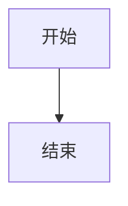

<!-- 由 scripts/m4_export_rules.py 的 SYNTAX_MATRIX 生成，勿手改。 -->

<!-- heading: 标题 1～3 级 -->
# 中文标题 Heading 1

## 二级标题 Section

### 三级标题 Sub

<!-- paragraph: 正文与行内标记 -->
正文段落 body text，含行内 `code`、**加粗**、*斜体*。

<!-- link: 链接 -->
含[链接](https://example.com)的段落。

<!-- ordered-list: 有序列表 -->
1. 第一项 first item
2. 第二项 second item
3. 第三项 third item

<!-- unordered-list: 无序列表 -->
- 无序项 bullet one
- 无序项 bullet two

<!-- blockquote: 引用块 -->
> 引用块 quote text

<!-- table: 表格 -->
| 列 A | 列 B |
| --- | --- |
| 甲 | 乙 |
| 丙 | 丁 |

<!-- code: 围栏代码块 -->
```rust
fn main() {
    println!("中文 code");
}
```

<!-- image: 图片 -->


<!-- rule: 分隔线 -->
---

<!-- inline-math: 行内公式 -->
行内公式 $E = mc^2$ 与后文。

<!-- display-math: 块级公式 -->
$$
a^2 + b^2 = c^2
$$

<!-- mermaid: Mermaid 图表 -->


<!-- footnote: 脚注 -->
末尾段落 end paragraph[^note]

[^note]: 脚注内容 footnote body
